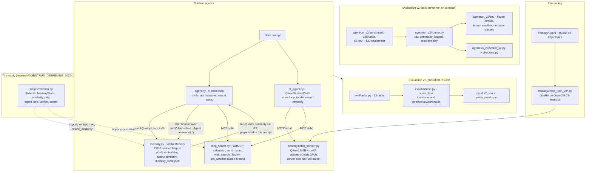
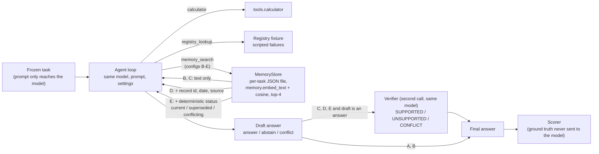

# AGENTRUN architecture: what the repository contains on 2026-11-11

This is an audit of the code as it is, not as the project is usually described. Two points matter for everything that follows:

1. **Memory is not served over MCP.** The MCP server (`mcp_server.py`) exposes four tools: `calculator`, `word_count`, `web_search`, `get_weather`. Long-term memory is a Python class (`memory.py`) called directly by the Gemini agent loop.
2. **The runtime has no verification step and no provenance tracking.** In this repository "verification" means `results/verify_results.py` (it re-tallies committed result files) and "provenance" means `provenance/` (experiment metadata: hyperparameters, seeds). Neither acts on an agent's answer. The Agentic RAG researcher project that explored these ideas is not in this repository.

So configurations C, D and E of the ablation are new experimental code (`scripts/memlab.py`), built for this study on top of the repository's own retrieval maths. They are not measurements of an existing AGENTRUN feature.

## Components

## One task traced end to end (Gemini agent, `main.py`)

Prompt: "What's my favorite number?" with `memory_store.json` present.

| Step | Code | What happens |
|---|---|---|
| 1 | `main.py:18` | `VectorMemory("memory_store.json")` loads 12 stored entries (JSON list of text, embedding, timestamp). |
| 2 | `agent.py` `Agent.connect` | Starts `mcp_server.py` as a subprocess over stdio, calls `list_tools()`, converts the four schemas to Gemini function declarations. |
| 3 | `agent.py` `Agent.run` | `long_term_memory.search(prompt, top_k=3)`: the prompt is tokenised, hashed into a 256-d vector, compared by cosine similarity with every entry; entries with similarity >= 0.2 are returned as plain text. |
| 4 | same | The texts are prepended: `[Relevant facts from long-term memory:] ... [Current user message:] ...`. No timestamp, source or id is passed on, and nothing checks whether two retrieved texts disagree. |
| 5 | loop | The model either returns function calls (executed through `session.call_tool`, result appended as a function response; a result starting with `ERROR` is marked `is_error`) or a final text. There is no retry logic for tool errors; the model simply sees the error text. |
| 6 | final | The final text is returned, and `"User asked: ... Agent answered: ..."` is appended to memory and written to disk. **The agent's own answer is stored as a memory with no check that it was correct.** |
| 7 | trace | A `RunTrace` (tool calls, latency, retry wait, max-step flag) is kept for the harness. |

The fine-tuned path (`ft_agent.py`) is the same loop with the model behind HTTP, the system prompt fixed to the training prompt, and **no memory at all**.

## Audit findings

| # | Finding | Evidence |
|---|---|---|
| 1 | Memory is used by the Gemini agent only; the Qwen agents and both benchmarks never touch it. No memory result exists anywhere in `results/`. | `grep` for `memory` in `ft_agent.py`, `agent_qwen.py`, `eval/`, `agentrun_v2/` |
| 2 | Retrieval is lexical: hashed unigrams and bigrams, 256 dimensions. It is not a sentence-embedding model. | `memory.py:28` |
| 3 | Memory records have text, embedding and a wall-clock timestamp. The timestamp is never read. There is no source, no validity, no supersession. | `memory.py:76` |
| 4 | Write policy stores the agent's own answers, so one wrong answer can be retrieved later as a "fact". | `agent.py`, final-answer branch |
| 5 | The 23-task benchmark has no task that needs memory, has conflicting evidence, or injects a tool failure other than division by zero and an unknown city. | `eval/tasks.py` |
| 6 | Existing tests: 186 collected; 185 pass and 1 fails on this Windows machine (`test_env_data_regenerates_byte_for_byte`, CRLF line endings in the regenerated corpus). `results/verify_results.py` reproduces Base 22, V1 18, E4 18, V2 23 of 23. | `logs/` and EXECUTION_LOG.md |
| 7 | The follow-up benchmark v2 (185 tasks) is sealed and has never been run on a model. Its `.sealed/` directory is still inside the repository; this study did not open it. | `docs/followup_status.md` |

## The research gap

The project's stated claim is about memory reliability, but nothing in the repository measures memory at all. The most valuable missing experiment is therefore a controlled test of the memory path itself: does it help when context is lost, and what does the agent do when what it retrieves is stale, contradictory or absent? That is what this study adds.

## The experimental harness (new)

