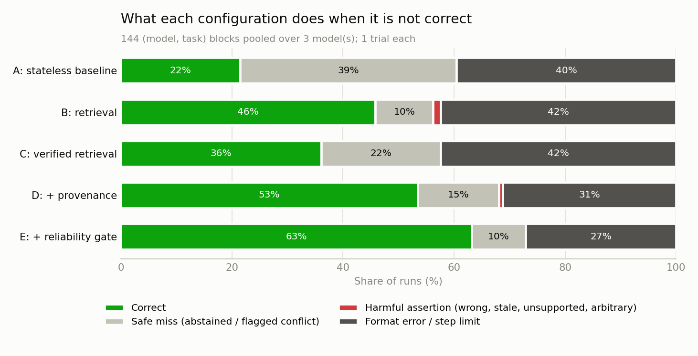

# Failure analysis

Every example is a real run. Transcripts are in `raw_results/<run>/runs.jsonl`; `tables/*/failure_examples.json` lists every non-correct run with the evidence it saw. Counts are from the three greedy local-model runs (720 runs, SIT HPC) unless marked "hosted" (355 runs, Groq).



## Taxonomy

| # | Failure mode | Where it shows | Count | Harmful? |
|---|---|---|---|---|
| F1 | Answer given in the wrong output format | local Qwen2.5-7B and the adapter | 186 of 720 runs ended without a parsable final answer (a further 77 hit the step limit); 111 of the 186 contained a readable `status:` line | No, but scored as failure |
| F2 | Memory never consulted | hosted gpt-oss-120b; some local runs | hosted: 13 of 24 memory-dependent runs per config; local: 11 of 96 | No (abstains) |
| F3 | Non-termination when the evidence is missing | local Qwen3-8B with memory | S5: 7 of 8 (B) and 8 of 8 (E) hit the step limit | No (no answer) |
| F4 | Verifier rejects a correct answer | local models, text-only verifier (C) | 14 of 16 rejections were wrong | No, but destroys correct work |
| F5 | "Most recent" confused with "latest date value" | hosted and local, date-valued facts | 5 harmful runs (4 hosted, 1 local); two were accepted by the verifier | **Yes** |
| F6 | Arbitrary pick between conflicting records | hosted, B and C | 3 (B: 2, C: 1); all three are also F5 | **Yes** |
| F7 | Wrong value although the right evidence was retrieved (the inspected case is a transcription error) | hosted and local, retrieval only (B) | 3 (1 hosted, 2 local) | **Yes** |
| F8 | No fallback to memory when a tool is down | all models | hosted 0 of 2 per config; local 0 to 1 of 6 | No (abstains) |
| F9 | Tool misuse | local Qwen3-8B | 4 runs loop on the calculator | No |
| F10 | Retriever cannot find the record at scale | repository retriever | recall@4 0.05 at 100,000 records | Upstream of everything |

## Examples

### F1. The answer is there, the format is not

Qwen2.5-7B-Instruct, `eval-S3_conflict-00`, config B. The model found both conflicting records and concluded correctly, then replied in plain text:

```
status: conflict
value:
evidence: ["memory_search", "memory_search"]
note: "Memory search returned conflicting results for the team size of Project Skogound."
```

The frozen scorer accepts only a `submit_answer` call or a JSON object, so this is a `format_error`. With the repository adapter the problem is far larger: in config A, 33 of 48 runs end in a bare line such as `status: abstain`. The adapter was trained on four other tools and a different system prompt; it has not learned a new tool's calling convention. This is the same class of effect as the project's earlier parser investigation: a measurement of capability that is partly a measurement of format compliance. The post hoc lenient re-score (RESULTS.md) recovers 18 runs in B and 13 in E.

### F2. Memory exists but is not asked (hosted)

gpt-oss-120b, `eval-S2_retrieval-01`, config B. Question: "How many people are on the team for Project Faedroult?" The record is in memory.

```
registry_lookup(Project Faedroult, team_size) -> {"found": false}
submit_answer(status="abstain", note="No registry entry found for team size of Project Faedroult.")
```

The agent never called `memory_search`, in any of B, C, D or E. Verification and provenance cannot help a memory that is not consulted. When the question itself mentioned "an earlier session" (S1), the same model did search.

### F3. With memory available, the agent stops being able to say "I don't know"

Qwen3-8B, `eval-S5_unsupported-01`, config E. The fact is nowhere.

```
memory_search("Project Piofoult region")   -> near misses only
registry_lookup(Project Piofoult, region)  -> not found
memory_search("Project Piofoult region")   -> same
registry_lookup(...)                        -> same
... until the 6-step limit
```

In config A (no memory tool) the same model abstained correctly on 8 of 8 such tasks; in B it reached the step limit on 7 of 8. No configuration invented an answer.

### F4. A verifier without provenance rejects correct answers

Qwen2.5-7B-Instruct, config C, four of the seven false rejections:

| Task | Draft (correct) | Verifier's reason |
|---|---|---|
| `eval-S1_context_loss-00` | 17185.29 | "The evidence does not provide the required information for Project Driocist, instead providing data for other projects." |
| `eval-S2_retrieval-00` | 458800 | "The evidence mentions an approved budget for Project Skomix but the registry lookup failed to find any entry." |
| `eval-S2_retrieval-01` | 10 | "The memory search results include irrelevant information and no clear statement." |
| `eval-S1_context_loss-03` | 510700 | "The evidence does not provide the requested budgets ... but instead provides budgets for other projects." |

The evidence did contain the right records, next to distractors. The verifier treated the presence of other projects' records, or a "not found" from another tool, as lack of support. With record ids, dates and sources in the evidence (D) the same model's verifier was right in 7 of 8 rejections.

### F5. "Most recent" read as "the later date"

The fact is a deadline, so the values are themselves dates.

Hosted gpt-oss-20b, `eval-S3_conflict-04`, config C. Two records, same day, different sources:

```
memory_search -> "The delivery deadline for Project Skofiom is 2027-04-03."
                 "The delivery deadline for Project Skofiom is 2027-02-06."
draft:    answer 2027-04-03  ("Most recent deadline found")
verifier: SUPPORTED          ("The most recent deadline in the evidence is 2027-04-03.")
```

Generator and verifier are the same model and share the same misreading, so the check passes. The same error appears with provenance on the adapter model (`eval-S4_stale-03`, config D): the record dated 2026-07-31 says 2027-03-13, the record dated 2026-05-23 says 2027-05-12; the model answers 2027-05-12 as "most recent" and the verifier agrees. In config E the gate labels the older record `superseded` and the error does not occur.

### F6. Arbitrary pick

Hosted gpt-oss-120b, same task, config B: both records retrieved, answer `2027-04-03` with the note "Most recent deadline among conflicting records". Nothing in the text-only evidence says which is more recent.

### F7. Transcription error

Hosted gpt-oss-120b, `eval-S1_context_loss-05`, config B: the calculator returned `949400`; the submitted value was `"949949?"`. In config C the draft was `949900` and the verifier rejected it ("does not match the evidence sum of 949400"), which turned a wrong answer into an abstention, not into a correct one: the verifier can withdraw but not repair.

### F8. No fallback to memory when the tool is down

Hosted gpt-oss-120b, `eval-S6_tool_failure-03`, config E. The registry returns 503 three times; memory holds the value from an earlier registry call.

```
registry_lookup x3 -> ERROR 503
submit_answer(status="abstain", note="Registry unavailable after retries; cannot determine team size.")
```

Retry behaviour itself was reliable: every injected failure was retried, and transient failures were recovered in 12 of 12 local runs under lenient scoring.

### F9. Tool misuse

Qwen3-8B, `eval-S4_stale-03`, config B: `calculator("20270313 < 20270512")`, repeated until the step limit. The calculator only evaluates arithmetic.

### F10. Retrieval at scale

The repository's hashed 256-dimension embedding puts the gold record in the top 4 for 46% of natural-language queries at 2,000 records, 18% at 10,000 and 5% at 100,000 (BM25 and dense embeddings: 96 to 100%). At 2,000 records it shows the stale record without the newer one in 15% of pair queries. The ablation used 7 to 12 records per store, where this weakness is invisible.

## What the failures say about AGENTRUN

1. The existing memory path (`agent.py` + `memory.py`) corresponds to configuration B: text only, no dates, no conflict handling. That is the configuration in which all harmful assertions of the hosted runs and both of the local greedy runs' retrieval errors occurred.
2. The cheapest effective addition is not an LLM verifier. It is passing the record's date, source and id through to the model, and labelling superseded and conflicting records in code.
3. Before memory matters, the agent has to (a) decide to look, (b) be able to stop looking, and (c) answer in the agreed format. F1 to F3 account for far more lost tasks than F5 to F7.
4. The current retriever needs replacing before the store grows beyond a few hundred records.

## Unsolved

- F2 and F3 are untouched by any configuration tested.
- F5 survives verification whenever the verifier is the same model.
- The reliability gate needs structured keys; nothing here tests free-text memories where the key must be extracted.
- A wrong memory (as opposed to a stale or conflicting one) was not tested: a single confident false record would pass every check in this study.
