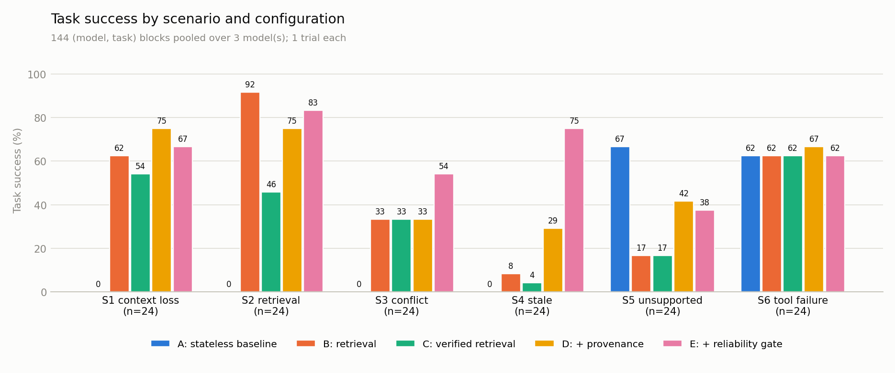
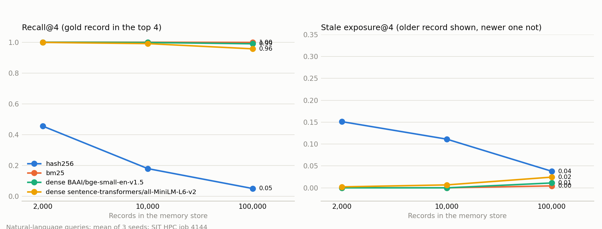

# Results

Every number comes from generated tables: `tables/hpc_greedy/`, `tables/hpc_all/`, `tables/hpc_greedy_lenient_posthoc/`, `tables/RETRIEVAL_AT_SCALE.md` (SIT HPC runs) and `tables/RESULTS_TABLES.md` (hosted-endpoint runs). Measured results come first; interpretation is a separate section.

## What ran

| Set | Where | Models | Blocks x configs | Runs | Status |
|---|---|---|---|---|---|
| **Local models (primary)** | SIT HPC, node `<compute-node>`, NVIDIA L40, Slurm array 4138 | Qwen2.5-7B-Instruct; Qwen3-8B; Qwen2.5-7B-Instruct + the repository's LoRA adapter (all greedy) | 3 x 48 x 5 | 720 | **complete** |
| Local models, sampled repeats | same array | Qwen2.5-7B T=0.7 seeds 1 and 2; Qwen3-8B T=0.7 seed 1 | 3 x 48 x 5 | 720 | **complete** |
| Hosted models | laptop calling the Groq endpoint | gpt-oss-120b (35 blocks), gpt-oss-20b (29), qwen3.8-27b (7) | 71 x 5 | 355 scored (358 written) | **truncated** by a 200,000 tokens/day cap |
| Retrieval at scale | SIT HPC job 4144, L40 | hash256 (AGENTRUN default), BM25, all-MiniLM-L6-v2, bge-small-en-v1.5 | 3 seeds x 3 store sizes x 300 queries x 2 query styles | 96 result rows | **complete** |
| Pilot | SIT HPC job 4136 | Qwen2.5-7B-Instruct, dev split | 12 x 5 | 60 | complete; development only, not a result |

A block is one task run under all five configurations by one model. One trial per cell. The 48 evaluation tasks, prompts and configurations are the ones frozen on 2026-11-11 09:27 UTC; nothing was changed for the HPC runs.

The adapter in the repository root (`adapter_model.safetensors`, SHA-256 `e50e7661...`, base Qwen2.5-7B-Instruct, 18 training steps) is not labelled V1 or V2 anywhere in the repository. Its file time (2026-09-01 21:20) falls between the V1 and V2 evaluations, which suggests V2, but that is an inference. It is called "the repository adapter" here.

## Measured results: local models on the L40 (complete, 144 blocks, greedy)

### Headline, strict scoring as frozen

| Configuration | Task success (95% Wilson CI) | Harmful assertions | Safe misses | Format or step-limit failures |
|---|---|---|---|---|
| A stateless baseline | 31/144 = 21.5% (16-29) | 0 | 56 | 57 |
| B retrieval | 66/144 = 45.8% (38-54) | 2 (1.4%) | 15 | 61 |
| C verified retrieval | 52/144 = 36.1% (29-44) | 0 | 31 | 61 |
| D + provenance | 77/144 = 53.5% (45-61) | 1 (0.7%) | 21 | 45 |
| E + reliability gate | 91/144 = 63.2% (55-71) | 0 | 14 | 39 |

### Paired comparisons on task success (144 pairs)

| Comparison | Difference (pp) | 95% bootstrap CI | Discordant pairs | McNemar exact p | Holm p |
|---|---|---|---|---|---|
| B - A (add memory) | +24.3 | +9.7 to +38.9 | 48 / 13 | <0.0001 | <0.0001 |
| C - B (add verifier) | **-9.7** | -16.7 to -4.2 | 0 / 14 | 0.0001 | 0.0005 |
| D - C (add provenance) | +17.4 | +9.7 to +25.7 | 35 / 10 | 0.0002 | 0.0005 |
| E - D (add reliability gate) | +9.7 | +0.7 to +18.8 | 26 / 12 | 0.034 | 0.034 |
| E - B | +17.4 | +7.6 to +28.5 | 34 / 9 | 0.0002 | 0.0005 |
| E - A | +41.7 | +27.1 to +55.6 | 73 / 13 | <0.0001 | <0.0001 |

Harmful assertions are too rare to separate: 0, 2, 0, 1, 0 of 144; no paired difference has p below 0.5.

### By model (successes of 48; strict)

| Model | A | B | C | D | E | Format/step failures A to E |
|---|---|---|---|---|---|---|
| Qwen2.5-7B-Instruct | 12 | 22 | 15 | 28 | 33 | 9, 19, 19, 10, 6 |
| Qwen3-8B | 13 | 30 | 27 | 32 | 34 | 13, 11, 11, 8, 12 |
| Qwen2.5-7B + repository adapter | 6 | 14 | 10 | 17 | 24 | 35, 31, 31, 27, 21 |

The ordering A < B, C < B, D > C, E >= D holds in all three.

### By scenario (pooled, strict; successes of 24)

| Scenario | A | B | C | D | E |
|---|---|---|---|---|---|
| S1 context loss | 0 | 15 | 13 | 18 | 16 |
| S2 retrieval | 0 | 22 | 11 | 18 | 20 |
| S3 conflict | 0 | 8 | 8 | 8 | 13 |
| S4 stale | 0 | 2 | 1 | 7 | 18 |
| S5 unsupported | 16 | 4 | 4 | 10 | 9 |
| S6 tool failure | 15 | 15 | 15 | 16 | 15 |

### Verifier (local models, pooled)

| Config | Drafts checked | Rejected, draft was wrong | Rejected, draft was right | Accepted, draft was wrong | Precision | Recall |
|---|---|---|---|---|---|---|
| C (text only) | 52 | 2 | **14** | 0 | 2/16 | 2/2 |
| D (with provenance) | 64 | 7 | 1 | 1 | 7/8 | 7/8 |
| E (with gate) | 68 | 1 | 2 | 0 | 1/3 | 1/1 |

### Other named metrics (local models, pooled, strict)

| Metric | A | B | C | D | E |
|---|---|---|---|---|---|
| Newest value given, date in record text (S4) | 0/12 | 2/12 | 1/12 | 4/12 | 9/12 |
| Newest value given, date only in metadata (S4) | 0/12 | 0/12 | 0/12 | 3/12 | 9/12 |
| Unsupported claim rate (S5) | 0/24 | 0/24 | 0/24 | 0/24 | 0/24 |
| Recovery after timeout or truncated response (S6) | 12/12 with lenient scoring; see below | | | | |
| Memory called at least once in S1-S4 | - | 85/96 | 85/96 | 85/96 | 85/96 |
| Evidence-grounded answer rate | 11/11 | 48/52 | 35/36 | 56/56 | 64/65 |

Efficiency per task (L40, greedy, pooled): end-to-end 3.46 s (A), 3.69 (B), 4.02 (C), 4.55 (D), 4.59 (E); model calls 3.90, 4.01, 4.37, 4.62, 4.43; prompt + completion tokens 3248, 3731, 3917, 4495, 4371. Run-to-run check: B and C drafts were identical in 144 of 144 blocks, so greedy decoding on the local GPU was deterministic.

### Sampled repeats (T = 0.7), strict, successes of 48

| Run | A | B | C | D | E |
|---|---|---|---|---|---|
| Qwen2.5-7B greedy | 12 | 22 | 15 | 28 | 33 |
| Qwen2.5-7B T=0.7 seed 1 | 11 | 25 | 20 | 25 | 33 |
| Qwen2.5-7B T=0.7 seed 2 | 10 | 24 | 16 | 21 | 33 |
| Qwen3-8B greedy | 13 | 30 | 27 | 32 | 34 |
| Qwen3-8B T=0.7 seed 1 | 12 | 32 | 31 | 30 | 37 |

Across the three Qwen2.5-7B runs the per-configuration spread is 2 to 7 tasks; E is highest in every run and A lowest in every run. Pooling all six local runs (288 blocks): A 64, B 147, C 119, D 153, E 194; harmful 0, 4, 1, 1, 0.

### Post hoc: lenient re-score (not part of the frozen protocol)

Most "format errors" of the Qwen2.5 models were complete answers written as plain `status: ... / value: ...` text instead of the required `submit_answer` call. `scripts/lenient.py` reads that form. The verifier never saw those drafts, so C, D and E are scored on unverified drafts in these cases.

| Configuration | Strict | Lenient (post hoc) |
|---|---|---|
| A | 31/144 | 34/144 |
| B | 66/144 | 84/144 |
| C | 52/144 | 70/144 |
| D | 77/144 | 86/144 |
| E | 91/144 | 104/144 |

Under lenient scoring the comparisons keep their signs: B - A +34.7 pp, C - B -9.7, D - C +11.1 (p = 0.02), E - D +12.5 (p = 0.004), E - B +13.9 (p = 0.001). Conflict detection (S3) becomes B 21/24, C 21/24, D 13/24, E 18/24, so the strict S3 numbers above understate B and C. S6 recovery after a transient failure is 12/12 in every configuration.

## Measured results: retrieval at scale (complete; SIT HPC job 4144)

Recall@4 with the user's question as the query, mean of 3 seeds:

| Retriever | 2,000 records | 10,000 | 100,000 |
|---|---|---|---|
| hash256, the repository's `memory.embed_text` | 0.456 | 0.180 | 0.051 |
| BM25 | 1.000 | 1.000 | 0.999 |
| all-MiniLM-L6-v2 | 0.999 | 0.991 | 0.957 |
| bge-small-en-v1.5 | 1.000 | 0.998 | 0.990 |

Stale exposure@4 (the older record of a pair is shown and the newer one is not): hash256 0.151, 0.111, 0.038 (falling only because it retrieves neither at scale); BM25 0.000 to 0.004; dense 0.000 to 0.024. With short keyword queries hash256 does better at small scale (0.896 at 2,000) and still collapses (0.176 at 100,000). In the 12-record stores of the ablation, hash256 recall@4 was 0.90 to 1.00, which is why retrieval did not limit the ablation.

Dense embedding throughput on the L40: 9,700 to 14,900 records/s, against 1,400 to 2,600 on the node's CPU. Peak GPU memory 628 MiB. Recall@1 tops out near 0.75 for every method because half the queries have two gold records.

## Measured results: hosted models (truncated, 71 blocks)

| Configuration | Task success (95% CI) | Harmful assertions | Safe misses |
|---|---|---|---|
| A | 20/71 = 28.2% (19-40) | 0 | 51 |
| B | 48/71 = 67.6% (56-77) | 4 (5.6%) | 19 |
| C | 47/71 = 66.2% (55-76) | 1 (1.4%) | 23 |
| D | 51/71 = 71.8% (60-81) | 0 | 20 |
| E | 50/71 = 70.4% (59-80) | 0 | 21 |

B - A +39.4 pp (CI +25.4 to +53.2, p < 0.0001). No difference among B, C, D, E is significant (C - B -1.4; D - C +5.6, p = 0.29; E - D -1.4). No format failures. Verifier in C: 3 correct rejections, 0 false rejections, 1 miss. gpt-oss-120b called memory in only 11 of 24 memory-dependent runs. Full tables: `tables/RESULTS_TABLES.md`.

## Interpretation

| Hypothesis | Local 7-8B models (complete) | Hosted larger models (truncated) | Verdict |
|---|---|---|---|
| H1 memory improves completion without context | +24.3 pp strict, +34.7 lenient, p < 0.0001 | +39.4 pp, p < 0.0001 | **Supported** in both sets and in all six models |
| H2 verification reduces wrong answers | Harmful 2 to 0 (not significant), but success **falls** 9.7 pp because the text-only verifier rejected 14 correct drafts and caught 2 wrong ones | Harmful 4 to 1 (not significant), no false rejections | **Not supported as stated.** A same-model verifier without provenance is net harmful on small models and neutral on larger ones |
| H3 provenance improves stale and conflict handling | D - C +17.4 pp (p = 0.0002); verifier precision 2/16 to 7/8; stale tasks 1/24 to 7/24 | +5.6 pp, not significant; metadata-only stale 0/5 to 3/5 | **Supported** on local models; directional on hosted ones |
| H4 the combination beats single components | E - B +17.4 pp (p = 0.0002); E - D +9.7 (p = 0.034) | E - B +2.8, not significant | **Supported for small models, not shown for larger ones** |
| H5 the components cost latency, tokens and add their own errors | +33% latency and +35% tokens from A to E; verifier false rejections; more step-limit failures | +58% latency, +58% tokens A to E | **Supported** |

Findings that go beyond the hypotheses:

1. **The benefit of the reliability machinery depends on model strength.** The deterministic gate lifts stale handling from 7/24 to 18/24 on 7-8B models and adds nothing measurable on the larger hosted models, which resolve dates from the metadata themselves.
2. **A verifier is only as good as its evidence.** Given text alone, the 7B verifier called correct answers unsupported because distractor records were also in the evidence or because the registry had said "not found". Given record ids, dates and sources, its precision rose from 2/16 to 7/8.
3. **Giving an agent memory made it worse at admitting ignorance.** On unsupported questions (S5) the stateless local agents abstained correctly 16/24; with memory this fell to 4/24. They did not invent answers (0 unsupported claims in 1,795 scored runs across both sets); they looped between memory and registry until the step limit.
4. **Output-format compliance is a first-order effect for small models**, the same lesson as AGENTRUN's earlier parser investigation. 57 to 61 of 144 strict failures in A to C are format or step-limit failures, and the repository adapter makes this much worse (35/48 in A) on a tool set it was not trained on.
5. **The repository's retriever does not scale.** It is adequate at 12 records and loses the gold record 95% of the time at 100,000.

## Limits on these conclusions

- One trial per cell for the headline; the sampled repeats show a spread of 2 to 7 tasks per configuration on the same model.
- Scenario cells have 24 blocks (local) or 10 to 13 (hosted): descriptive only.
- Fixtures are synthetic one-sentence facts with clean entity and attribute keys; the reliability gate depends on those keys. Memory writing is done by the harness, not the agent.
- The three "local models" are two base models and one adapter on the same base; they are not three independent model families.
- The lenient re-score is post hoc and was designed after seeing the failures.
- The hosted set is truncated and dominated by two gpt-oss models; hosted Qwen has 7 blocks.
- Configurations C, D and E are new code written for this study, not pre-existing AGENTRUN features. The fine-tuned adapters were trained for a different tool set and system prompt.
- The retrieval experiment uses templated sentences; lexical methods are favoured by that, so BM25's near-perfect score should not be read as a general ranking of retrievers.
