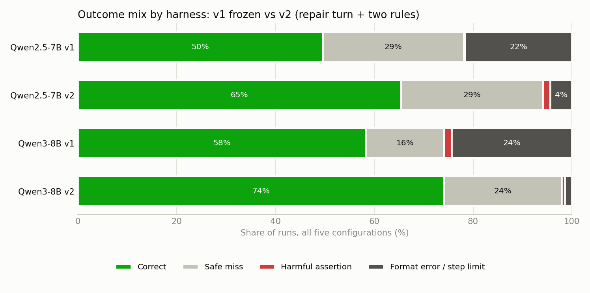
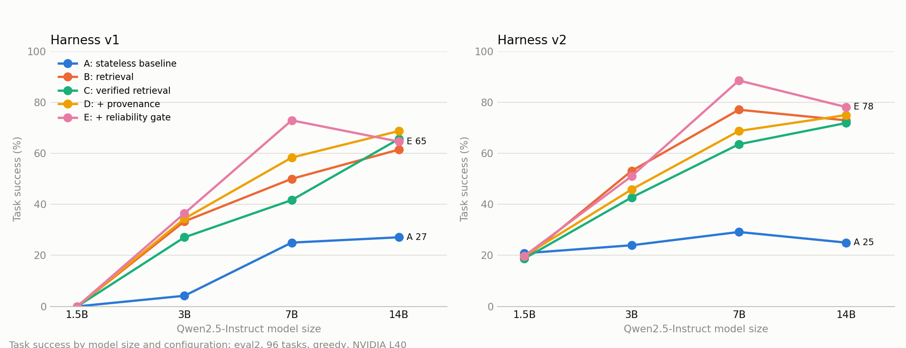

# Results, campaign 2 (12 November 2026, SIT HPC)

Design and rationale: [CAMPAIGN2_PLAN.md](CAMPAIGN2_PLAN.md), written before any campaign-2 result existed. All numbers below come from `tables/c2/C2_TABLES.md`, generated by `scripts/analyze_c2.py` from `raw_results/c2_*`. The extra breakdowns (empty-value answers, repair-turn use, calculator loops, adapter identity) were computed from the same raw files and are reproducible with `scripts/c2_breakdowns.py` (output in `logs/c2_breakdowns.log`).

## What ran

Slurm array 4148 on node `<compute-node>` (NVIDIA L40), 21 jobs, two at a time.

| Jobs | What | Status |
|---|---|---|
| 0-3 | Qwen2.5-7B and Qwen3-8B, harness v1 and v2, 96 fresh tasks x 5 configurations | complete, 4 x 480 runs |
| 4-5 | AGENTRUN's own benchmarks through the repository's v2 runner: legacy 23 tasks and 55-task v2 dev split, base and adapter, budgets 3 and 6, three sampled repeats | complete, 10 legacy runs, 4 v2-dev runs |
| 6-11 | Qwen2.5 size sweep: 1.5B, 3B, 14B (7B is jobs 0 and 2), v1 and v2 | complete, 6 x 480 runs |
| 12-13 | Retriever inside the agent: hash256 and BM25, 2,000 background records per store | complete, 2 x 192 runs |
| 14-20 | dense retriever; repair-only harness (v1r); adapter on the memory benchmark; two sampled repeats of v2 | **never started** |

Jobs 0-13 finished with exit 0 between 04:58 and 08:42 UTC. Jobs 14-20 were never dispatched. A check at 12:08 UTC (recorded in `../AGENTRUN_DEEPENING_2026-11-12/CAMPAIGN2_STATUS.md`) found the login node, which runs the Slurm controller, unreachable and `squeue` on the compute node failing with "Unable to contact slurm controller". At 13:50 UTC neither cluster address answered from the laptop, so the current state of the cluster is unknown.

Totals analysed: **5,184 agent runs** on the memory benchmark, plus **450 task evaluations** on the repository's own benchmarks (230 legacy, 220 v2 dev). Per-task data for one v2-dev run (adapter, budget 3) stayed on the cluster; only its summary, printed in the Slurm log, is available.

Leakage and isolation audit: 77 of 77 checks pass (17 static checks on the eval2 split and 5 transcript checks on each of the 12 agent runs; for the two padded-store runs the per-run store file check does not apply because padded stores are not written to disk).

## 1. The first study replicates on 96 fresh tasks (frozen v1 harness)

| | A stateless | B memory | C + verifier | D + provenance | E + gate |
|---|---|---|---|---|---|
| Qwen2.5-7B | 24/96 | 48/96 | 40/96 | 56/96 | 70/96 |
| Qwen3-8B | 23/96 | 61/96 | 59/96 | 63/96 | 74/96 |
| Pooled, success | 24.5% | 56.8% | 51.6% | 62.0% | 75.0% |
| Pooled, harmful answers | 0 | 5 | 1 | 2 | 0 |

| Comparison (192 pairs) | Difference | 95% bootstrap CI | Discordant | McNemar p |
|---|---|---|---|---|
| B - A, add memory | +32.3 pp | +24.0 to +40.6 | 76 / 14 | <0.0001 |
| C - B, add text-only verifier | -5.2 pp | -8.9 to -2.1 | 1 / 11 | 0.006 |
| D - C, add provenance | +10.4 pp | +4.2 to +16.7 | 29 / 9 | 0.002 |
| E - D, add reliability gate | +13.0 pp | +7.8 to +18.8 | 28 / 3 | <0.0001 |
| E - B, all three | +18.2 pp | +10.9 to +25.0 | 45 / 10 | <0.0001 |

Every direction from the 48-task study holds. The gate effect, the weakest result on 11 November (p = 0.034), is now significant in each model separately (Qwen2.5-7B +14.6 pp, p = 0.0005; Qwen3-8B +11.5 pp, p = 0.007). Provenance is significant on Qwen2.5-7B (+16.7 pp, p = 0.0004) but not on Qwen3-8B alone (+4.2 pp, p = 0.48).

Scenario detail (pooled, of 32): stale records S4 go 4 (B) to 10 (D) to 25 (E). Unsupported questions S5 go from 27 correct without memory to 16 with memory in every memory configuration.

## 2. A measured fix for the failure modes: harness v2

v2 adds one repair turn (if the final message is not a `submit_answer` call, a fixed notice asks for one) and two behavioural rules in the system prompt: search memory before deciding a fact is unavailable or giving up on a failing tool; never repeat a call that already returned a valid result, and abstain if neither memory nor the registry has the fact. It was checked on the 12 dev tasks only and frozen before eval2 was run.

| 480 paired runs per model | Qwen2.5-7B v1 | Qwen2.5-7B v2 | Qwen3-8B v1 | Qwen3-8B v2 |
|---|---|---|---|---|
| Task success | 49.6% | **65.4%** | 58.3% | **74.2%** |
| Difference (95% CI), p | | +15.8 pp (+8.3 to +22.9), <0.0001 | | +15.8 pp (+9.8 to +22.3), <0.0001 |
| Format errors + step-limit failures | 104 | 21 | 117 | 7 |
| Unsupported questions answered correctly, config E (of 16) | 15 | 16 | **1** | **16** |
| Memory consulted in S1-S4, configs B-E (of 256) | 208 | 232 | 256 | 256 |
| Fell back to memory when the tool stayed down (of 16) | 1 | 12 | 0 | 6 |
| False conflict flags | 14 | 34 | 16 | 30 |
| Harmful answers | 1 | 7 | 7 | 3 |
| Repair turns used | - | 14 | - | 0 |

What this shows:

- **The rules, not the repair turn, did most of the work.** Qwen3-8B never triggered the repair turn, so its entire +15.8 pp came from the two prompt rules. On Qwen2.5-7B the repair turn fired 14 times (all 14 ended correct), against 105 runs that improved.
- **All three failure modes from the first study respond to the fix.** Not consulting memory (208 to 232 of 256), not falling back to memory when a tool is down (1 to 12 of 16), and looping instead of abstaining (Qwen3-8B, S5 config E: 1 to 16 of 16).
- **The fix has costs.** False conflict flags roughly double on both models. On Qwen2.5-7B harmful answers rise from 1 to 7: six are wrong values on context-loss tasks in config B, and four of those were submitted **without any tool call**, each with the same invented value (12500.00) and each citing `registry_lookup` and `calculator` as its evidence. In C, D and E the verifier rejected the same drafts, which is the one place in this study where the text-only verifier clearly earned its keep (6 correct rejections on Qwen2.5-7B v2, against 1 under v1).

With v2, do the component effects survive? Pooled over both models (192 pairs): A 29.2%, B 81.8%, C 70.3%, D 75.5%, **E 92.2%**. C - B -11.5 pp (p < 0.0001), D - C +5.2 pp (p = 0.11, no longer significant), E - D +16.7 pp (p < 0.0001). Stale tasks S4 with the gate: 32 of 32. The verifier penalty and the gate benefit are robust to the harness; the provenance step is not.

## 3. Model size inside one family (Qwen2.5-Instruct, same backend)

Task success of 96:

| Size | Harness | A | B | C | D | E | Format/step failures (of 480) |
|---|---|---|---|---|---|---|---|
| 1.5B | v1 | 0 | 0 | 0 | 0 | 0 | 480 |
| 1.5B | v2 | 20 | 18 | 18 | 19 | 19 | 8 |
| 3B | v1 | 4 | 32 | 26 | 33 | 35 | 238 |
| 3B | v2 | 23 | 51 | 41 | 44 | 49 | 35 |
| 7B | v1 | 24 | 48 | 40 | 56 | 70 | 104 |
| 7B | v2 | 28 | 74 | 61 | 66 | **85** | 21 |
| 14B | v1 | 26 | 59 | 63 | 66 | 62 | 113 |
| 14B | v2 | 24 | 70 | 69 | 72 | 75 | 66 |

Paired effect of each component (pp; * = p < 0.05):

| Size | B - A memory (v1 / v2) | C - B verifier | D - C provenance | E - D gate |
|---|---|---|---|---|
| 1.5B | 0.0 / -2.1 | 0.0 / 0.0 | 0.0 / +1.0 | 0.0 / 0.0 |
| 3B | +29.2* / +29.2* | -6.2* / -10.4* | +7.3 / +3.1 | +2.1 / +5.2 |
| 7B | +25.0* / +47.9* | -8.3* / -13.5* | +16.7* / +5.2 | +14.6* / +19.8* |
| 14B | +34.4* / +47.9* | +4.2 / -1.0 | +3.1 / +3.1 | -4.2 / +3.1 |

Reading it model by model, with what the transcripts show:

- **1.5B never uses memory.** Under v1 every run fails the output format. Under v2 the format is fixed but the model called `memory_search` in 0 of 256 memory-dependent runs; its ~20% comes from abstention and tool-failure tasks. It asserted 24 wrong values, all of them after the repair turn had asked it for an answer: 14 on tool-failure tasks, 8 on context-loss tasks, 2 on unsupported questions.
- **3B benefits from memory and from nothing else.** The gate does not transfer: stale tasks with the gate are 2 of 16. Its harmful-answer counts (24 under v1, 37 under v2) overstate the problem: 15 and 20 of them are `answer` statuses with an empty value. Genuinely wrong asserted values: 9 and 17.
- **7B is where every component pays off**, and it is the best configuration in the whole study (85 of 96, harness v2, config E).
- **14B gains the most from memory and little from the rest, but not because it "does not need" them.** The gate still lifts stale tasks (D to E: 8 to 12 under v1, 10 to 14 under v2), and under v1 it costs conflict tasks (14 to 7). And it hit the step limit on 25 (v1) and 19 (v2) context-loss runs; in 21 and 19 of its step-limit runs it had called the calculator with `round(...)`, which the tool rejects, and kept retrying. Part of the flat 14B curve is a tool-interface limitation, not reasoning. In addition, in 268 (v1) and 274 (v2) of its 480 runs the 14B model wrote part of its free-text reasoning in Thai while producing well-formed English tool calls; 71 of its 86 (v1) and all 43 (v2) format errors are runs with Thai output. No other model did this, and whether it is model behaviour or a serving-stack interaction is unknown. 14B jobs took 96 and 123 minutes against 33 for 7B.

So the capacity pattern is an inverted U for the reliability components (no value at 1.5B and 3B, large at 7B, small at 14B), while memory itself helps every model from 3B up. This is one model family, one greedy trial per cell, and a single tool implementation.

## 4. The retriever matters end to end

Qwen2.5-7B, harness v2, memory scenarios S1-S4, configurations B, D and E (192 paired runs). Every store padded with the same 2,000 background records.

| Store | Success B / D / E (of 64) | Overall | Gold record found by the agent's own queries | Harmful |
|---|---|---|---|---|
| 7-12 records, hash256 (as in the ablation) | 45 / 36 / 56 | 71.4% | 1.00 | 7 |
| + 2,000 records, hash256 (AGENTRUN default) | 27 / 22 / 31 | **41.7%** | 0.76 | 10 |
| + 2,000 records, BM25 | 42 / 41 / 52 | 70.3% | 1.00 | 6 |

Hash256 with 2,000 records vs no padding: -29.7 pp (95% CI -39.1 to -20.3, p < 0.0001). BM25 vs hash256 at 2,000 records: +28.6 pp (+19.3 to +38.5, p < 0.0001). The retrieval-only experiment of 11 November predicted the collapse; this shows it reaches the agent's answers, and that swapping the retriever restores almost all of the lost performance. The dense retriever (job 14) did not run.

## 5. AGENTRUN's own benchmarks, client-matched

These answer the open question from the fine-tuning study. Same runner for base and adapter (`agentrun_v2.runner`: training system prompt, the four MCP tool schemas, deterministic frozen tool environment, raw generations logged, the repository's client-side parser), scored by the repository's own frozen scorers.

**Which adapter this is.** The adapter in the repository root (SHA-256 `e50e7661...`) is the **V2** adapter: it is byte-identical to `checkpoint-18/adapter_model.safetensors`, whose `trainer_state.json` shows 6 optimizer steps per epoch at batch 2 x 4 accumulation, which is 46 training examples (V2); 35 examples (V1) would give 5. V2's training set added 11 trajectories designed from V1's failures on these same 23 tasks (`docs/paper_agentrun_2.0.md`, "evaluation adaptation").

| | Legacy 23 tasks, frozen `eval/harness.py` (R0) | Benchmark v2 dev split, 55 fresh tasks (R2 correct) |
|---|---|---|
| Base, budget 3, greedy | 21/23 | 92.7% |
| Base, budget 6, greedy | 22/23 | 94.5% |
| Base, budget 3, T=0.7, three seeds | 21, 22, 22 | - |
| V2 adapter, budget 3, greedy | 23/23 | 92.7% (from the job log) |
| V2 adapter, budget 6, greedy | 23/23 | 92.7% |
| V2 adapter, budget 3, T=0.7, three seeds | 23, 23, 23 | - |

Base failures on the legacy set are `adversarial_division_by_zero` (every run) and `chain_weather_then_calc` (two runs). Adapter vs base, legacy, budget 3: 2 tasks only the adapter passes, 0 only the base passes (p = 0.5). v2 dev, budget 6: 0 only the adapter, 1 only the base (p = 1.0).

Interpretation: the V2 adapter's 23/23 reproduces exactly, five times out of five, with a matched client. Its advantage exists only on the 23 tasks its extra training data was designed from; on 55 fresh tasks that pass the repository's leakage checks it is no better than the base model. This is the pattern that evaluation adaptation predicts. The V1 adapter is not in the repository, so the original 95.7% to 78.3% drop could not be re-run.

## What this campaign adds to the story

1. The first study's component effects replicate on twice as many fresh tasks, with a stronger gate effect.
2. The three failure modes found yesterday have a measured fix (+15.8 pp on both models, p < 0.0001), and its side effects are quantified.
3. The value of reliability machinery depends on model capacity in a non-monotonic way, measured inside one family and one backend.
4. The default retriever's collapse at scale reaches end-task success, and BM25 fixes it.
5. With a matched client, the adapter's legacy-benchmark advantage does not transfer to fresh tasks.

## Not established

- The split between repair turn and prompt rules on Qwen2.5-7B (the v1r jobs did not run). The Qwen3-8B inference above follows from the repair turn never firing.
- Dense retrieval inside the agent (job 14).
- The adapter on the memory benchmark (jobs 17-18).
- Run-to-run spread under v2 (jobs 19-20). Greedy decoding was deterministic on 11 November (B and C drafts identical in 144 of 144 blocks); sampled spread on the legacy set was 21-22 of 23.
- Anything beyond Qwen. Anything with free-text memories, agent-written memories, or a single confidently wrong record.
- Statistical significance for harmful-answer differences: there are too few events.
