# AGENTRUN: Complete Research Dossier

**Alyssa L. — MITACS research interview — 12 November 2026**

*Persistent memory, retrieval, provenance and verification in multi-tool LLM agents: architecture, experiments, evidence and limitations.*

## How to read this document

Every number in this dossier was recomputed from raw experiment outputs by `build/verify_numbers.py`. That script re-scores each agent run with the frozen scorer and re-derives every aggregate, interval and test with code written independently of the original analysis scripts. All thirteen headline figures quoted in the dossier brief matched exactly. Historical numbers from before November 2026 (the 23-task fine-tuning results) come from the committed result files and were re-tallied by `results/verify_results.py`; they are labelled *historical*.

Four kinds of evidence are kept apart throughout, and each table says which it is:

- **Historical:** the original 23-task fine-tuning results (September 2026, Colab T4).
- **Pilot (campaign 1):** the first controlled memory ablation on 48 tasks (11 November).
- **Fresh validation (campaign 2):** the replication and revised-harness experiments on 96 new tasks (12 November).
- **Exploratory (campaign 2):** the model-size sweep, the retriever-inside-the-agent runs, and the client-matched re-run of AGENTRUN's own benchmarks.

Repository paths are relative to the repository root unless stated. "The study folder" means `research/AGENTRUN_DEEPENING_2026-11-11/`.

<!-- pagebreak -->

# 1. Executive summary

## 1.1 What AGENTRUN is

AGENTRUN is a multi-tool LLM agent runtime. A language model runs a think–act–observe loop. It calls tools (a calculator, a word counter, web search and weather) through the Model Context Protocol (MCP), and it keeps a persistent memory of earlier interactions in a small vector store. The project began as a QLoRA fine-tuning study: can a 7-billion-parameter model (Qwen2.5-7B-Instruct) be specialised for multi-tool use on a free Colab T4 GPU, and how should that be evaluated?

## 1.2 The problem it addresses

A tool-using agent can be *capable*, meaning it can solve a task when everything goes right, without being *reliable*, meaning it behaves correctly when things go wrong. Things go wrong all the time: the earlier conversation is gone, the memory holds an outdated or contradictory record, the evidence for an answer does not exist, or a tool fails. Persistent memory is the standard remedy for lost context. But memory adds new ways to fail, such as retrieving the wrong record, trusting a stale one, picking arbitrarily between two that conflict, or answering when the honest answer is "I don't know". The research question of this dossier is:

> **Research question.** How do persistent memory, retrieval, evidence provenance and verification change the reliability of a multi-tool LLM agent, and how does that depend on model capacity?

## 1.3 What was built and evaluated

- **An audit of the original system.** Memory had never been evaluated; the shipped runtime has no verification and no provenance; memory is an in-process store, not an MCP service.
- **A controlled experimental harness** (`memlab.py`) with five configurations that differ by exactly one component: A stateless, B memory retrieval, C + a text-only verifier, D + provenance (record id, date, source), E + a deterministic staleness and conflict gate.
- **Six scenarios** with programmatic ground truth: lost context, retrieval among distractors, conflicting records, stale records, unsupported questions, tool failure.
- **Two frozen evaluation splits** of fictional, seeded tasks (48 and 96 tasks) with an automated leakage audit (77 of 77 checks pass on the second).
- **About 6,600 agent runs on the SIT HPC** (two NVIDIA L40 GPUs under Slurm) over two days, plus 355 runs on hosted models, a retrieval-at-scale benchmark up to 100,000 records, and a client-matched re-run of AGENTRUN's own benchmarks.

## 1.4 The strongest measured findings

Table: The central result. Task success on 96 fresh tasks, Qwen2.5-7B and Qwen3-8B pooled (192 task blocks per configuration; recomputed from raw outputs).

| Configuration | Original harness | Revised harness |
|---|---|---|
| A stateless | 24.5% | 29.2% |
| B memory retrieval | 56.8% | 81.8% |
| C + text-only verifier | 51.6% | 70.3% |
| D + provenance | 62.0% | 75.5% |
| E + staleness gate | 75.0% | 92.2% |

1. **Memory helps.** +32.3 percentage points pooled (95% CI +21.9 to +42.2, p < 0.0001), in every model from 3B parameters up, on two independent fresh splits.
2. **A same-model verifier that sees only text hurts.** −5.2 points (original harness, p = 0.006) and −11.5 points (revised, p < 0.0001). It rejects correct answers it cannot trace to a source.
3. **Provenance plus a deterministic staleness rule make memory dependable on stale data.** Stale-record tasks: 4 of 32 with plain retrieval, 25 of 32 with the rule (32 of 32 with the revised harness).
4. **Memory can stop an agent from abstaining.** Without memory, Qwen3-8B correctly declined 15 of 16 unanswerable questions; with the full system, 1 of 16. It did not invent answers. It searched in a loop until it ran out of steps. Two prompt rules restored 16 of 16 and raised overall success by 15.8 points on both models.
5. **Capacity matters non-monotonically.** Inside one model family (Qwen2.5, 1.5B to 14B), the reliability components pay off most at 7B. The 1.5B model never consults memory, and the 3B model gains from memory only.
6. **Retrieval quality reaches the answers.** With 2,000 extra records in memory, AGENTRUN's default retriever cuts task success from 71.4% to 41.7%; BM25 restores 70.3%.
7. **The fine-tuned adapter does not generalise.** It scores 23 of 23 on the original benchmark in five out of five matched runs, but on 55 fresh tasks it is no better than its base model (92.7% vs 94.5%).

## 1.5 What remains unresolved

- Seven of 21 jobs in the second HPC campaign never started, because the Slurm controller became unreachable. Missing: dense retrieval inside the agent, the repair-only harness variant, the adapter on the memory benchmark, and sampled repeats of the revised harness.
- All tasks are synthetic, templated facts with clean entity–attribute keys.
- The model-size sweep covers one family, one greedy trial per cell, and one tool implementation. The 14B model showed an unexplained switch to Thai in its free-text reasoning.
- Differences in harmful answers are too rare to test statistically.
- The sealed 130-task test split built in October has not been used.

<!-- pagebreak -->

# 2. Research motivation and problem statement

## 2.1 What goes wrong with a stateless agent

A stateless LLM agent sees only its context window: the system prompt, the current conversation and the tool results of this episode. Nine failure modes follow, and the experiments in this dossier observe each of them in real transcripts:

1. **Context limits.** Facts from earlier sessions are simply absent. In every experiment here, the stateless configuration A solves none of the context-loss, retrieval, conflict or stale-record tasks, because the answer exists only in memory.
2. **Loss of information across sessions.** "In an earlier session I told you the budget" is unanswerable without persistence.
3. **Retrieving irrelevant information.** A memory search returns the most similar records, which often belong to another project or another attribute.
4. **Conflicting knowledge.** Two records state different values for the same fact on the same day.
5. **Outdated memories.** An old value and a newer value coexist; similarity search does not know which is current.
6. **Unsupported answers.** The agent states a value for which it has no evidence.
7. **Incorrect tool execution.** Malformed calls, unsupported operations (for example `round(...)` in a calculator that only does arithmetic), or tools that time out.
8. **Repeated tool calls.** The agent re-issues a call that already returned "not found".
9. **Failure to abstain.** The agent cannot conclude "the evidence is insufficient" and keeps searching until a step limit stops it.

## 2.2 Why "add a vector database" is not enough

A vector store fixes the first two problems and makes the next three more likely. Similarity search ranks by surface resemblance, not by truth, recency or authority. It will happily return a superseded record, return two contradictory records without saying so, or return near-misses for a question that has no answer. Unless the agent is given the means to judge what it retrieved, more memory means more confident errors. That is the motivation for testing provenance (where and when a record came from), verification (an explicit check of the answer against the evidence) and a deterministic reliability rule (which record is current) as separate, measurable components.

## 2.3 Capability versus reliability

The distinction is central to this work and to the scoring:

- **Capability** is whether the agent can produce the right answer when the answer is available, which is measured as task success on answerable tasks.
- **Reliability** is whether the agent's *behaviour* is appropriate across conditions: it answers when the evidence supports an answer, flags a conflict when the evidence conflicts, abstains when there is no evidence, and recovers from tool failures. It also requires that when it is wrong, it is wrong safely, by abstaining rather than asserting a false value.

For this reason every run is classified into one outcome, and **task success** is reported separately from **harmful assertions**. An over-cautious agent loses task success but causes no harm; a confident wrong answer is harmful even if it is rare. Chapter 7 defines every outcome.

## 2.4 Research question and hypotheses

The working question is: *How can persistent memory, retrieval, provenance and verification improve the reliability of multi-tool LLM agents, and how do these mechanisms behave across different model capacities?* It was broken into five hypotheses, fixed before the first evaluation run (`RESEARCH_QUESTION.md` in the study folder):

Table: Hypotheses and their current status (details in Chapters 10–13).

| | Hypothesis | Status |
|---|---|---|
| H1 | Memory improves task completion when context is missing | Supported on both fresh splits and in every model from 3B up |
| H2 | Verification reduces unsupported or incorrect answers | Not supported as stated: text-only verification lowers success; its effect on harmful answers is too small to test |
| H3 | Provenance improves handling of stale and conflicting records | Supported on 7-8B models; small or absent on larger hosted models |
| H4 | The combined system beats any single component | Supported at 7-8B; not at 3B, 14B or on the larger hosted models |
| H5 | The components cost latency, tokens and add their own errors | Supported: about +33% latency and +35% tokens; more false conflicts |

<!-- pagebreak -->

# 3. Evolution of AGENTRUN

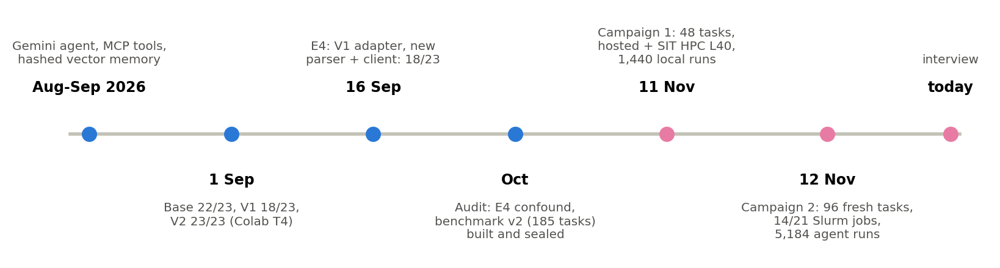

## 3.1 The original AGENTRUN (August–September 2026)

The first system had two independent halves (Diagram A in Chapter 4).

**The runtime.** `agent.py` runs a Gemini model in a think–act–observe loop of at most six steps. It launches `mcp_server.py` (a FastMCP server) as a subprocess over stdio, discovers its four tools with `list_tools()`, and executes the model's function calls through `session.call_tool`. Before each user turn it searches `memory.py`'s `VectorMemory` for the three most similar past entries and prepends them to the prompt; after each final answer it stores "User asked: … Agent answered: …" as a new memory. `ft_agent.py` runs the same loop with a Qwen model served from a Colab notebook over HTTP; it uses the MCP tools but no memory.

**The fine-tuning study.** QLoRA adapters for Qwen2.5-7B-Instruct were trained on small sets of tool-use trajectories and evaluated on a fixed, machine-scored, 23-task multi-tool benchmark (`eval/tasks.py`, 12 categories). Every condition was run once, greedily, with a three-step budget, against live web search and weather APIs.

Table: Historical results on the 23-task benchmark (committed result files, re-tallied by `results/verify_results.py`).

| Condition | Adapter (training trajectories) | Parser | Passed | Accuracy |
|---|---|---|---|---|
| Base | none | single-pass | 22 / 23 | 95.7% |
| V1 | V1 (35) | single-pass | 18 / 23 | 78.3% |
| E4 | V1 (35), unchanged | two-pass | 18 / 23 | 78.3% |
| V2 | V2 (46 = 35 + 11 targeted) | two-pass | 23 / 23 | 100.0% |

What these numbers do and do not show:

- **Base to V1: a regression after specialisation.** Fine-tuning on 35 trajectories lowered the score from 22 to 18 tasks.
- **V1 to E4: not a parser-only ablation.** E4 held the V1 adapter fixed and changed the server-side tool-call parser from single-pass to two-pass. The aggregate did not move, but four individual tasks flipped. E4 was also scored by a different, notebook-local evaluation client with different tool schemas and executors, on a later date with live data, and only pass/fail was recorded. So the V1-to-E4 comparison changes the parser *and* the client.
- **E4 to V2: an iterative intervention, not a controlled experiment.** V2 added 11 training trajectories written *after inspecting V1's failures on these same 23 tasks*, and its training run also changed the optimizer and memory settings. The repository calls this *evaluation adaptation*: the prompts of the 11 trajectories are disjoint from the benchmark prompts (checked by a unit test), but they were designed against this benchmark. The 100% is therefore not evidence of generalisation.

**Why 23 tasks could not establish generalisation.** With 23 tasks and one run per condition, a single task is 4.3 percentage points; Base to V2 is one task. The tasks were used during development; the V2 training data was shaped by them; there was no held-out split; and the live tools made reruns non-reproducible. These limitations motivated benchmark v2 (October: 185 tasks in 17 families, a 55-task development split and a 130-task sealed test split, with leakage checks) and the controlled studies that follow.

## 3.2 First research deepening: campaign 1 (11 November 2026)

The audit showed that memory, the feature the project's research question was about, had never been measured. Campaign 1 built the experimental harness and ran the first controlled ablation:

- 48 frozen evaluation tasks (8 per scenario) plus 12 development tasks, all with fictional entities.
- Five configurations A–E on every task, paired.
- Hosted models (gpt-oss-120b, gpt-oss-20b, qwen3.8-27b through an API), stopped at 71 complete task blocks by a 200,000-token daily quota.
- Local models on the SIT HPC: Qwen2.5-7B, Qwen3-8B and Qwen2.5-7B with the repository adapter (greedy), plus three sampled repeats: 1,440 agent runs.
- A retrieval-only benchmark comparing AGENTRUN's hash embedding with BM25 and two dense models at 2,000 to 100,000 records.

**What was learned:** memory helps strongly; a text-only verifier hurts small models; provenance and the gate help; and three unsolved failure modes appeared: agents that do not consult memory, agents that loop instead of abstaining, and small models that answer in the wrong format.

## 3.3 Second research deepening: campaign 2 (12 November 2026)

An audit of campaign 1 listed what was weak and designed one experiment for each weakness (`CAMPAIGN2_PLAN.md`, committed before any campaign-2 result existed):

- **A fresh 96-task split** (16 per scenario, new names from a disjoint slice of the name pool), frozen before any run, to replicate campaign 1.
- **A revised harness (v2)** to address the three failure modes: one repair turn plus two prompt rules, developed on the 12 dev tasks only. The original harness (v1) was re-run on the same fresh tasks as the control.
- **A model-size sweep** within one family and one serving stack: Qwen2.5-Instruct 1.5B, 3B, 7B and 14B.
- **Retrieval inside the agent:** every memory store padded with 2,000 background records, comparing the hash retriever with BM25.
- **A client-matched re-run of AGENTRUN's own benchmarks** (the 23 original tasks and the 55-task v2 development split), base versus adapter.

It ran as Slurm array 4148 (21 jobs). Fourteen completed with exit code 0; seven were never dispatched because the Slurm controller became unreachable (Chapter 16).

<!-- pagebreak -->

# 4. Complete system architecture

This chapter separates three things that are easy to conflate: the **original runtime** (what AGENTRUN ships), the **research harness** (experimental code written for this study), and **components that exist only in the harness** and have not been integrated into the runtime.

## 4.1 Diagram A: the original runtime

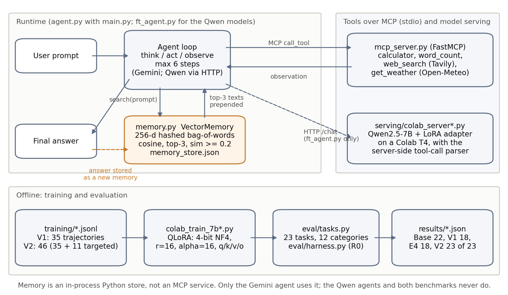

Table: Components of the original runtime and where they live.

| # | Component | Implementation | Notes |
|---|---|---|---|
| 1 | User / task input | `main.py` (interactive), `eval/tasks.py` (benchmark) | |
| 2 | Agent runtime | `agent.py` `Agent.run`; `ft_agent.py` `QwenRemoteClient.run` | at most 6 steps (Gemini) or 3 (benchmark budget) |
| 3 | LLM client | `google.genai` chat (Gemini); HTTP to `serving/colab_server*.py` (Qwen) | the Qwen server also parses tool calls |
| 4 | MCP interface | `mcp_server.py` (FastMCP, stdio) | tools only: calculator, word_count, web_search, get_weather |
| 5 | Persistent memory | `memory.py` `VectorMemory`, file `memory_store.json` | Gemini agent only; text, embedding, timestamp |
| 6 | Memory retrieval | `VectorMemory.search` | top 3 by cosine, similarity at least 0.2 |
| 7 | Embedding and ranking | `memory.embed_text` | 256-d hashed bag of words and bigrams; no neural model |
| 8 | Tool execution | `session.call_tool`; `tools.py` | errors returned as text starting with "ERROR" |
| 9 | Evidence collection | `RunTrace` (tool calls, observations) | for the benchmark scorer, not for the model |
| 10 | Provenance tracking | **not implemented** | the stored timestamp is never read |
| 11 | Verification | **not implemented** | `results/verify_results.py` re-tallies result files; it does not check answers |
| 12 | Temporal reliability checks | **not implemented** | |
| 13 | Conflict detection | **not implemented** | |
| 14 | Response generation | the model's final text | |
| 15 | Logging | `RunTrace`; `results/*.json` | |

One task traced end to end (Gemini agent, "What's my favorite number?", `memory_store.json` holding 12 entries):

1. `main.py` loads `VectorMemory("memory_store.json")`.
2. `Agent.connect` starts `mcp_server.py` over stdio, lists its tools and converts their schemas to Gemini function declarations.
3. `Agent.run` calls `search(prompt, top_k=3)`: the prompt is tokenised, hashed into a 256-dimensional vector and compared by cosine similarity with every stored entry.
4. Matching texts are prepended as `[Relevant facts from long-term memory:] … [Current user message:] …`. No date, source or identifier is passed on, and nothing checks whether two retrieved texts disagree.
5. The model either requests function calls (run through MCP, results appended) or returns a final text.
6. The final text is returned and stored as a new memory. **The agent's own answer is written back into memory without any check that it was correct.**

> **Correction to a common description.** AGENTRUN is sometimes described as having "MCP-based memory". In the code, MCP is the tool layer only. Memory is a Python object inside the agent process, and the Qwen agents used in the fine-tuning study do not use it at all.

## 4.2 Diagram B: the research harness

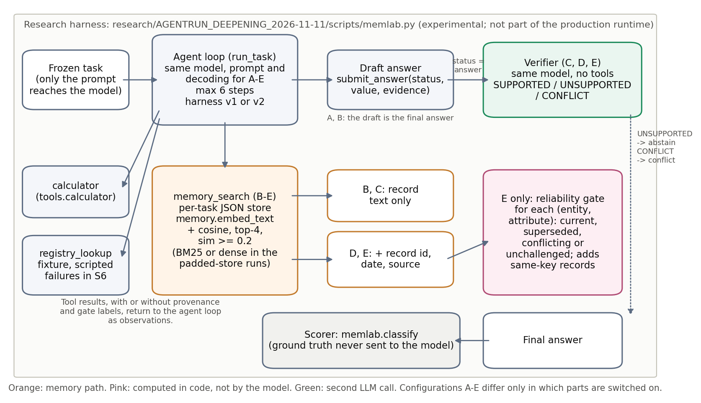

The harness lives in the study folder: `scripts/memlab.py` (fixtures, memory store, gate, agent loop, verifier, scorer), `scripts/run_ablation.py` (runner), `scripts/hf_client.py` (local-GPU model client), `scripts/stores.py` (padded stores with hash, BM25 or dense retrieval) and `scripts/run_v2_hpc.py` (a bridge to the repository's own v2 runner). It reuses two things from the original code: `memory.embed_text` and `memory.cosine_similarity` for retrieval, and `tools.calculator` for arithmetic.

Table: Which components are original, research-only, or wrappers.

| Component | Status |
|---|---|
| Hash-embedding retrieval, calculator | **Original**, reused unchanged |
| MCP tool server, Gemini agent, `VectorMemory` write-back | **Original**, not used by the harness |
| `memory_search` tool with a per-task JSON store | **Research-only** wrapper around the original retrieval |
| `registry_lookup` tool with scripted failures | **Research-only** fixture |
| `submit_answer` tool (status, value, evidence) | **Research-only** |
| Provenance fields in memory results (D, E) | **Research-only** |
| Verifier call (C, D, E) | **Research-only** |
| Reliability gate (E) | **Research-only** |
| Repair turn and two prompt rules (harness v2) | **Research-only** |
| BM25 and dense retrievers in padded stores | **Research-only** |
| Local-GPU client with the repository's tool-call parser | **Wrapper** around `agentrun_v2.parser` |

**None of the research-only components has been integrated into the production runtime.** The shipped agent corresponds to configuration B: text-only memory retrieval, no verification, no provenance and no gate.

## 4.3 The experimental workflow

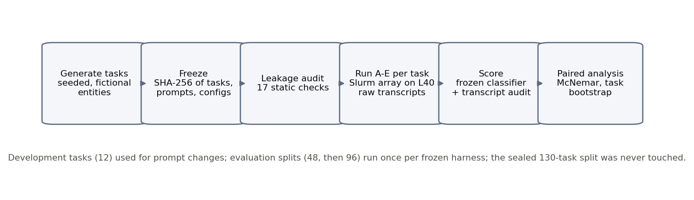

Each campaign follows the same sequence. Tasks are generated from a seed; the evaluation split, the prompts and the configuration are hashed into a freeze record; the static leakage audit runs; the runner refuses to start if any hash differs; every (task, configuration) is run and logged in full; the frozen scorer classifies each run; the transcript audit re-checks isolation; and only then is the paired analysis run.

<!-- pagebreak -->

# 5. Technical deep dive: persistent memory

## 5.1 Why an LLM agent needs external memory

A language model's knowledge has two sources: its weights (fixed at training time) and its context window (rebuilt on every call). Neither holds facts that a user stated last week. Even a very long context window does not solve this: it must be refilled every session, the cost of attention grows with its length, and the model must still find the relevant sentence among everything else. External persistent memory moves that problem outside the model. Facts are written to a store, and for each new request a retriever selects a handful of them to put into the context. The model then reasons over a short, relevant excerpt instead of everything ever said.

The price is a new dependency. The answer is now only as good as (a) what was written, (b) what the retriever selects, and (c) whether the model can judge what it was given. Each of those is a separate failure point, and the experiments test (b) and (c).

## 5.2 Context window versus persistent memory

Table: Context window and persistent memory compared.

| | Context window | Persistent memory |
|---|---|---|
| Lifetime | one model call | across sessions |
| Selection | everything in the prompt | a retriever chooses top-k records |
| Failure mode | facts absent | wrong, stale, conflicting or irrelevant records retrieved |
| Cost | grows with length on every call | retrieval plus a few hundred tokens of results |
| Trust signal | none needed: the user just said it | needs provenance: who said it, when |

## 5.3 How AGENTRUN's original memory works

`memory.py` implements a deliberately simple, dependency-free vector store:

1. **Tokenisation.** Lower-case the text and take the alphanumeric runs (`[a-z0-9]+`).
2. **Hashed embedding.** Each token is hashed with SHA-256. The first four bytes choose one of 256 dimensions and one bit chooses a sign (+1 or −1). Numeric tokens weigh 1.5; each adjacent token pair (bigram) is hashed the same way with weight 0.5.
3. **Similarity.** Cosine similarity between the query vector and every stored vector.
4. **Retrieval.** The three highest-scoring entries with similarity at least 0.2.
5. **Persistence.** A JSON list of {text, embedding, timestamp} in `memory_store.json`, rewritten on every addition.
6. **Write policy.** After each final answer the agent stores "User asked: … Agent answered: …".

```math
\mathrm{sim}(q, m) = \frac{\mathbf{e}(q) \cdot \mathbf{e}(m)}{\lVert \mathbf{e}(q) \rVert \, \lVert \mathbf{e}(m) \rVert}, \qquad \mathbf{e}(x) \in \mathbb{R}^{256}
```

This is a lexical method in vector form, a kind of feature hashing. Two texts are similar when they share words and word pairs, regardless of meaning. Its advantages are no model download, determinism and transparency. Its weaknesses are collisions in only 256 dimensions and no notion of synonymy, both of which become decisive as the store grows (Chapter 14). The stored timestamp is never read, so recency plays no role. Writing the agent's own answers back means one wrong answer can later be retrieved as a "fact".

## 5.4 Memory in the research harness

The harness keeps the original retrieval mathematics but changes everything around it so that memory can be tested under control:

- **Structured records.** Each record has `record_id`, `entity`, `attribute`, `value`, `recorded_on` (a date), `source` (`meeting_notes`, `imported_doc` or `user_statement`) and `text`, built from one of six templates. Example from the evaluation data: *"The delivery deadline for Project Traekaelt is 2027-03-13."*
- **Isolation.** Every (task, configuration) pair gets its own store, written to a JSON file and reloaded from disk before the agent runs, so the agent reads persisted state. No store is shared between tasks, configurations or models. The transcript audit checks after each run that each store held exactly its own task's records.
- **Written by the harness, not the agent.** Memory writing is controlled, so the experiments isolate retrieval and use and say nothing about the write policy.
- **Retrieval.** Top 4 by the original hash-embedding cosine, threshold 0.2. In the padded-store runs, BM25 or a dense model replaces it.
- **What the model sees.** In B and C a memory search returns record text only. In D and E each result also carries its id, date and source. In E each result additionally carries a status computed in code, and any stored record with the same (entity, attribute) key is added to the result.

## 5.5 Distractors, conflicts and stale records by construction

The scenarios (Chapter 9) build each difficulty into the fixture rather than hoping it occurs:

- **Distractors.** A retrieval task has one gold record among eleven others: three about the same project but other attributes, four about other projects with the same attribute, and four random. Similarity search is designed to be tempted.
- **Conflicts.** Two records for the same fact, the same date, two different sources, two different values. There is no correct value to pick; the correct behaviour is to report the conflict.
- **Stale records.** An older and a newer record for the same fact. In half the tasks the date is written into the text ("As of 2026-07-31: …"); in the other half it exists only in the `recorded_on` metadata, which configurations B and C never show the model.

A real stale-record example from campaign 1 (task `eval-S4_stale-03`): *"What is the delivery deadline for Project Traekaelt?"* Memory holds 2027-03-13 (recorded 2026-07-31) and 2027-05-12 (recorded 2026-05-23). The correct answer is 2027-03-13, the more recently *recorded* value. Because the values are themselves dates, a model can confuse "the most recent record" with "the later deadline", and several did (Chapter 15).

## 5.6 Temporal validity: the reliability gate

The gate (configuration E, `memlab.reliability_status`) applies a last-write-wins rule with a tie rule. For a retrieved record it collects every stored record with the same (entity, attribute):

- if all of them hold the same value: **unchallenged**;
- else, if the record is older than the latest date and a latest-dated record disagrees with it: **superseded**, listing the newer record ids;
- else, if another record with the same latest date holds a different value: **conflicting**, listing the rivals;
- otherwise: **current**.

The rule is a few lines of deterministic code. It needs clean keys, which the fixtures provide and real memories do not. That is the main threat to its external validity.

## 5.7 Failure modes found in memory use

Chapter 15 gives transcripts; in summary:

- **Memory not consulted.** In campaign 1, gpt-oss-120b called `memory_search` in only 11 of 24 memory-dependent runs per configuration. On fresh tasks under the original harness, Qwen2.5-7B consulted memory in 208 of 256 such runs, and the 1.5B model in none.
- **Conflict picked arbitrarily.** With text-only results, two same-day records were sometimes resolved by choosing one.
- **Stale value asserted.** The older record was presented as current.
- **No fallback.** When the registry tool stayed down, agents rarely thought to check memory (1 of 16 for Qwen2.5-7B under the original harness).
- **No stopping rule.** With a memory tool, Qwen3-8B alternated memory and registry searches until it ran out of steps instead of abstaining.

<!-- pagebreak -->

# 6. Technical deep dive: retrieval

## 6.1 Embeddings and similarity

An embedding maps text to a vector so that similar texts get nearby vectors. **Sparse lexical** representations count shared words. **Dense semantic** embeddings come from a neural encoder trained so that paraphrases land close together. Retrieval ranks stored records by a score against the query and returns the top k.

Three methods were compared:

- **hash256 (AGENTRUN default).** Feature-hashed bag of words and bigrams in 256 dimensions, cosine similarity (Section 5.3). Lexical; no training.
- **BM25.** The classic probabilistic ranking function over word counts. It rewards query terms that are frequent in a record and rare across the collection, and normalises for record length:

```math
\mathrm{BM25}(q, d) = \sum_{t \in q} \mathrm{IDF}(t)\, \frac{f(t,d)\,(k_1 + 1)}{f(t,d) + k_1 \left(1 - b + b \frac{|d|}{\mathrm{avgdl}}\right)}
```

  Implemented with `rank_bm25` (Okapi, default k1 = 1.5, b = 0.75).
- **Dense.** `sentence-transformers/all-MiniLM-L6-v2` and `BAAI/bge-small-en-v1.5`, both small encoders producing 384-dimensional normalised embeddings, ranked by dot product.

## 6.2 Metrics

For a query with gold set G and ranked results R, where R_k is the top k:

```math
\mathrm{Recall@}k = \frac{|G \cap R_k|}{|G|}, \qquad \mathrm{Precision@}k = \frac{|G \cap R_k|}{k}, \qquad \mathrm{MRR@}k = \frac{1}{\mathrm{rank\ of\ first\ gold\ in\ } R_k}
```

- **nDCG@k** (normalised discounted cumulative gain) weights hits by position, dividing each by log2(rank + 1), and normalises by the ideal ordering. It is standard for graded relevance. **It was not computed in these experiments**, because relevance here is binary and the raw rankings were not stored; MRR covers position sensitivity.
- **Stale exposure@k** (defined for this study): among queries whose gold set is an older and a newer record of the same fact, the share where the top k contains the older record but not the newer one. This is the case where retrieval alone hands the agent a stale fact.
- **Indexing time, throughput and query latency** were measured with wall-clock timers on the SIT HPC node.

## 6.3 The retrieval-only experiment

Exploratory, SIT HPC job 4144 (12 November, 03:40–03:43 UTC). Memory stores of 2,000, 10,000 and 100,000 templated records, three seeds each. 300 queries per store: 150 single-fact queries and 150 whose fact has an older and a newer record. Two query styles: the user's natural-language question (`nl`) and a short keyword query (`kw`). Dense models were run on the L40 and, for timing, on the node's CPU.

Table: Retrieval-only results, natural-language queries, mean of three seeds (recomputed from `raw_results/hpc_retrieval_bench/results.jsonl`).

| Retriever | Store size | Recall@4 | Recall@10 | MRR@10 | Stale exposure@4 | Query ms |
|---|---|---|---|---|---|---|
| hash256 | 2,000 | 0.456 | 0.650 | 0.372 | 0.151 | 0.10 |
| hash256 | 10,000 | 0.180 | 0.411 | 0.176 | 0.111 | 0.40 |
| hash256 | 100,000 | 0.051 | 0.072 | 0.053 | 0.038 | 4.59 |
| BM25 | 2,000 | 1.000 | 1.000 | 0.905 | 0.000 | 1.43 |
| BM25 | 100,000 | 0.999 | 1.000 | 0.888 | 0.004 | 90.63 |
| MiniLM-L6 (GPU) | 2,000 | 0.999 | 0.999 | 0.990 | 0.002 | 0.22 |
| MiniLM-L6 (GPU) | 100,000 | 0.957 | 0.984 | 0.947 | 0.024 | 7.60 |
| bge-small (GPU) | 2,000 | 1.000 | 1.000 | 0.999 | 0.000 | 0.21 |
| bge-small (GPU) | 100,000 | 0.990 | 0.998 | 0.984 | 0.011 | 13.66 |

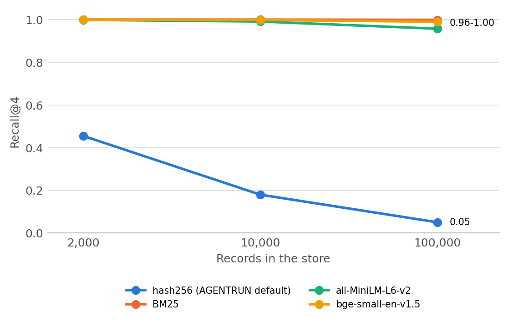

Observations:

- **The hash retriever degrades steeply**, from 0.46 to 0.05 recall@4, because 256 hashed dimensions cannot separate tens of thousands of similar sentences. Its stale exposure *falls* at scale only because it stops retrieving either record of a pair.
- **BM25 stays near perfect** on these templated records. It benefits from the project names being rare tokens that IDF rewards. That is a property of the fixtures, so BM25's score here is not a general ranking of retrievers.
- **The dense models degrade slightly** at 100,000 records (MiniLM 0.957, bge-small 0.990).
- **Cost:** on the L40, dense indexing ran at 9,700–14,900 records per second against 1,400–2,600 on the CPU; peak GPU memory was 628 MiB. BM25 queries became slow at 100,000 records (91 ms each) with this pure-Python implementation.

## 6.4 Retrieval accuracy is not task success

Recall measures whether the gold record reaches the top k. Task success also requires that the agent decides to search, phrases a useful query, reads the right record among the returned ones, handles conflicts and dates, and answers in the agreed format. The two can diverge in both directions. At 7–12 records, recall was close to 1.0 in the ablation, yet success was far lower, because most failures were in use, not retrieval. At 2,000 records, end-task success fell less than recall would suggest, because the agent's own queries were often more specific than the user's question. Chapter 14 measures retrieval inside the full agent directly.

<!-- pagebreak -->

# 7. Technical deep dive: provenance and verification

## 7.1 Provenance

**Evidence provenance** is information about where a piece of evidence came from and when: a stable identifier, a source and a date. It turns "a sentence the retriever returned" into "record m-03, from meeting notes, recorded on 2026-07-31". That matters for three reasons:

- **Recency.** With dates, "which value is current?" becomes answerable.
- **Conflict.** With sources and dates, two disagreeing records can be recognised as a genuine conflict (same date) rather than an update.
- **Accountability.** An answer can cite the record it relied on, and a checker can compare the answer against that record.

In the harness, provenance is three fields added to each memory result in configurations D and E. Configurations B and C retrieve exactly the same records but show only their text.

## 7.2 Verification

A **verifier** is a second check after the agent drafts an answer. In the harness it is one extra call to the *same* model with no tools. It receives the question, every tool result the agent saw (verbatim, so with or without provenance, matching the configuration) and the draft, and returns one of three verdicts:

- **SUPPORTED:** the evidence states the requested fact with this value, and any disagreeing evidence is clearly older.
- **UNSUPPORTED:** the evidence does not establish the fact for this project and attribute, or the value does not match, or it relies on an outdated value. The final answer becomes *abstain*.
- **CONFLICT:** the evidence holds different values and it cannot be established which is current. The final answer becomes *conflict*.

The verifier is called only when the draft is an answer. It can **withdraw** an answer but never **repair** one.

## 7.3 Why a verifier can reject a correct answer

The verifier's judgement is only as good as its view of the evidence. Without provenance, the evidence is a list of sentences, typically the right record next to records about other projects, plus a registry result that said "not found". A same-model verifier read that mixture as lack of support. Real verdicts from campaign 1, Qwen2.5-7B, configuration C, each rejecting a **correct** draft:

- *"The evidence does not provide the required information for Project Driocist, instead providing data for other projects."* (correct draft: 17185.29)
- *"The evidence mentions an approved budget for Project Skomix but the registry lookup failed to find any entry for the entity/attribute."* (correct draft: 458800)

There is also a structural limit: when the generator and the verifier are the same model, they share blind spots. In one transcript both read "most recent deadline" as "the later date", and the check passed a wrong answer (Chapter 15). This matches published findings that LLMs often fail to correct themselves without external feedback (Huang et al., 2023; Kamoi et al., 2024).

Table: Verifier decisions (positive = draft rejected; truth = the draft was not correct). Recomputed from raw outputs.

| Data | Config | Drafts checked | Correct rejections | Wrong rejections | Missed wrong drafts | Precision |
|---|---|---|---|---|---|---|
| Campaign 1, local 7-8B | C (text) | 52 | 2 | 14 | 0 | 2/16 |
| Campaign 1, local 7-8B | D (provenance) | 64 | 7 | 1 | 1 | 7/8 |
| Campaign 1, hosted | C (text) | 30 | 3 | 0 | 1 | 3/3 |
| Campaign 2, v1, pooled | C (text) | 81 | 4 | 11 | 1 | 4/15 |
| Campaign 2, v1, pooled | D (provenance) | 91 | 4 | 6 | 2 | 4/10 |
| Campaign 2, v2, pooled | C (text) | 97 | 7 | 22 | 1 | 7/29 |
| Campaign 2, v2, pooled | D (provenance) | 101 | 11 | 12 | 1 | 11/23 |

Provenance consistently raises the verifier's precision, but on the fresh tasks it does not make it reliable: roughly half of its rejections are still wrong. The success gain from D over C therefore comes partly from the *agent* using dates during its search, not only from a better verifier.

## 7.4 The outcome taxonomy

Every run receives exactly one outcome from the frozen classifier `memlab.classify`. The distinctions matter; several interview questions turn on them.

Table: Outcome definitions. "Harmful" groups the four outcomes that assert something false.

| Outcome | Expected behaviour | What the agent did | Harmful? |
|---|---|---|---|
| Correct answer | answer | answered with the right value (numbers within 0.011; text by normalised containment) | no |
| Correct abstention | abstain | abstained | no |
| Correct conflict flag | conflict | reported a conflict | no |
| Over-abstention | answer or conflict | abstained although the evidence supported an answer or a conflict flag | no (safe miss) |
| False conflict | answer or abstain | reported a conflict that the task did not contain | no (safe miss) |
| Wrong value | answer | answered with a different value | **yes** |
| Stale value | answer | answered with the older, superseded value | **yes** |
| Unsupported claim | abstain | answered although no evidence existed | **yes** |
| Arbitrary pick | conflict | answered with one of two conflicting values | **yes** |
| Format error | any | the final message was not a parsable answer | no (failure) |
| Step limit | any | used all 6 steps without a final answer | no (failure) |

Two further terms:

- An **evidence-supported answer** is one whose value literally appears in a tool result the agent received (memory, registry or calculator). Across both campaigns, nearly all answers at 7–8B were evidence-supported. The exceptions are informative: four campaign-2 answers of 12500.00 were given with no tool call at all (Chapter 15).
- **Strict and secondary scoring.** All headline numbers use the strict, frozen scorer. One post-hoc secondary score (`lenient.py`) also accepts an answer written as plain "status: … value: …" text. It is reported only where labelled, and it never replaces the strict score.

<!-- pagebreak -->

# 8. QLoRA and model specialisation

## 8.1 LoRA: low-rank adaptation

Fine-tuning all 7.6 billion weights of a 7B model needs several times the model's memory for gradients and optimizer state. LoRA freezes the pretrained weight matrix W0 and learns a low-rank update instead (Hu et al., 2021):

```math
W = W_0 + \frac{\alpha}{r} B A, \qquad A \in \mathbb{R}^{r \times d_{\mathrm{in}}},\; B \in \mathbb{R}^{d_{\mathrm{out}} \times r},\; r \ll d
```

B starts at zero, so training starts from the base model exactly. Only A and B are trained. With rank r = 16 and alpha = 16 (scale 1) on the four attention projections of Qwen2.5-7B, the adapter has **10,092,544 trainable parameters**, counted from the tensor shapes in `adapter_model.safetensors`. That is 224 tensors (28 layers × 4 projections × A and B), about 0.13% of the base model. The shapes confirm the architecture: A is 16 × 3584 everywhere; B is 3584 × 16 for the query and output projections and 512 × 16 for the key and value projections (grouped-query attention with 4 key-value heads of dimension 128).

## 8.2 QLoRA: quantised base, full-precision adapter

QLoRA (Dettmers et al., 2023) stores the frozen base model in 4-bit NormalFloat (NF4) and computes in 16-bit, so a 7B model fits in a 15 GB T4 together with its adapter, activations and optimizer state. Gradients flow through the quantised base into the adapter only.

Table: Training configuration (from `training/colab_train_7b*.py` and `adapter_config.json`; verified in `provenance/hyperparameters.md`).

| Setting | Value |
|---|---|
| Base model | Qwen/Qwen2.5-7B-Instruct |
| Quantisation | 4-bit NF4, fp16 compute |
| LoRA rank / alpha / dropout | 16 / 16 / 0.05 |
| Target modules | q_proj, k_proj, v_proj, o_proj |
| Learning rate, epochs | 2e-4, 3 |
| Batch | 2 per device x 4 accumulation = 8 |
| Max sequence length | 1024 tokens |
| Objective | next-token cross-entropy on assistant turns only (`DataCollatorForCompletionOnlyLM`) |
| V1 data | 35 tool-use trajectories |
| V2 data | 46 = the 35 plus 11 written after inspecting V1's failures |
| V2-only changes | paged 8-bit AdamW, gradient checkpointing, `use_cache=False` |

## 8.3 The fine-tuning history, read carefully

- **Specialisation can cost general behaviour.** V1 fell from the base model's 22 to 18 of 23. That is a regression after narrow fine-tuning on 35 examples. "Catastrophic forgetting" is too strong a name for a four-task change on one run, but it is the same direction.
- **Infrastructure confounds.** E4 held the adapter fixed and changed the parser and the evaluation client; the total stayed at 18 while four tasks flipped. A benchmark score can move, or stay still, for reasons that have nothing to do with the weights.
- **Evaluation adaptation.** V2's extra data was designed from V1's failures on the benchmark it was then scored on. Its 23 of 23 is a measurement on a benchmark the training process had looked at.

## 8.4 Which adapter is in the repository

The adapter in the repository root (SHA-256 beginning `e50e7661`) is byte-identical to `checkpoint-18/adapter_model.safetensors`. That checkpoint's `trainer_state.json` records 18 optimizer steps over 3.0 epochs, so **6 steps per epoch**. With a per-device batch of 2 and 4 accumulation steps, 35 training examples give 18 micro-batches and 5 optimizer steps per epoch, while 46 examples give 23 micro-batches and 6. **The repository adapter is therefore the V2 adapter.** This identification comes from arithmetic on the training log, not from a label; no file in the repository names it.

## 8.5 The client-matched re-run (campaign 2, exploratory)

Base model and V2 adapter were run through the same client: the repository's own v2 runner with the training system prompt, the four MCP tool schemas, a deterministic frozen tool environment (a frozen search corpus and weather snapshot instead of live APIs), logged raw generations and the repository's two-pass parser. They were scored by the repository's own frozen scorers.


Table: Client-matched results (recomputed from `raw_results/c2_legacy23_*` and `c2_v2dev55_*`).

| Run | Original 23 tasks (frozen R0 scorer) | 55 fresh v2-dev tasks (R2 correct) |
|---|---|---|
| Base, budget 3, greedy | 21 / 23 | 51 / 55 (92.7%) |
| Base, budget 6, greedy | 22 / 23 | 52 / 55 (94.5%) |
| Base, budget 3, T = 0.7, seeds 1-3 | 21, 22, 22 | — |
| V2 adapter, budget 3, greedy | 23 / 23 | 92.7% (job log only) |
| V2 adapter, budget 6, greedy | 23 / 23 | 51 / 55 (92.7%) |
| V2 adapter, budget 3, T = 0.7, seeds 1-3 | 23, 23, 23 | — |

The base model fails `adversarial_division_by_zero` in every run and `chain_weather_then_calc` in two. On the original tasks, 2 tasks are passed only by the adapter and none only by the base (exact McNemar p = 0.5). On the fresh tasks at budget 6, 0 are correct only for the adapter and 1 only for the base (p = 1.0).

## 8.6 Why the historical result is not evidence of generalisation

The V2 adapter reproduces its 23 of 23 perfectly, even under sampling, so the historical result was not luck or noise. But its advantage exists only on the 23 tasks its additional training data was designed from. On 55 fresh tasks that pass the repository's leakage checks against the training data, it is no better than the base model. That is exactly the pattern evaluation adaptation predicts, and it is now an observed result rather than a caveat. The adapter also transferred poorly to the memory benchmark, a tool set it was not trained on: in campaign 1 it reached 24 of 48 in configuration E against 33 for its base model, mostly through answers in the wrong format. The V1 adapter is not in the repository, so the original 95.7% to 78.3% drop could not be re-run under a matched client.

<!-- pagebreak -->

# 9. Experimental methodology

## 9.1 Configurations

Table: The five configurations. Everything not listed (model, decoding, system prompt, tool permissions, step budget, task) is identical across them.

| Config | memory_search | Memory results show | After an answer draft |
|---|---|---|---|
| A stateless | not offered | — | nothing |
| B memory + retrieval | offered | record text | nothing |
| C + text-only verifier | offered | record text | verifier call |
| D + provenance-aware verifier | offered | text, id, date, source | verifier call (sees the same fields) |
| E + reliability gate | offered | D + a computed status per record, plus same-key records | verifier call |

Every configuration also has `calculator`, `registry_lookup` and `submit_answer`. In S1–S5 the registry returns "not found", so memory is the only source. Fixed settings: temperature 0 (greedy) unless stated, model seed 20261111, at most 6 agent steps, top-4 retrieval with similarity at least 0.2, 700 new tokens per call on the local GPU (1,200 on the hosted endpoint, which also counted hidden reasoning tokens).

## 9.2 Scenarios

Table: The six scenarios. Counts are per split (48-task eval / 96-task eval2).

| Scenario | Fixture | Correct behaviour | Variants |
|---|---|---|---|
| S1 context loss | two facts "from an earlier session", only in memory, plus 5 distractors; needs arithmetic | answer (number) | budget per member; combined budget |
| S2 retrieval | 1 gold record among 11 hard distractors | answer | six attribute types |
| S3 conflicting evidence | two records, same fact, same date, different sources and values | report a conflict | — |
| S4 stale information | an older and a newer record for the same fact | answer with the newer value | date written in the text; date only in metadata |
| S5 unsupported question | the fact exists nowhere; near-miss records do | abstain | plain; question falsely presupposes an earlier session |
| S6 tool failure | the fact is in the registry, which is scripted to fail | see variants | timeout then OK; truncated JSON then OK (answer); always 503, nothing in memory (abstain); always 503, value in memory (answer) |

Each split has an equal number of tasks per scenario: 8 in the 48-task split and 16 in the 96-task split.

## 9.3 The datasets: do not conflate them

Table: Every task set used in this project.

| Set | Size | Built | Used for | Status |
|---|---|---|---|---|
| Original benchmark | 23 tasks | 2026-08 | historical fine-tuning results; client-matched re-run | used during development; V2 training data designed from it |
| Benchmark v2 dev | 55 tasks | 2026-10 | client-matched base vs adapter (exploratory) | leakage-checked against training data |
| Benchmark v2 test | 130 tasks | 2026-10 | nothing yet | **sealed, never opened** |
| memlab dev | 12 tasks | 2026-11-11 | harness and prompt development only | names disjoint from both eval splits |
| memlab eval (campaign 1) | 48 tasks | frozen 2026-11-11 09:27 UTC | pilot ablation | run with harness v1 only |
| memlab eval2 (campaign 2) | 96 tasks | frozen 2026-11-12 04:54 UTC | replication, harness v2, size sweep, retrieval | disjoint names; frozen before any run |

## 9.4 Isolation and leakage control

The project's earlier result was invalidated by evaluation adaptation, so isolation is checked by code, not asserted (`scripts/leakage_audit.py`; 77 of 77 checks pass on eval2):

- **Ground-truth protection.** Only the task prompt is sent directly. Records reach the model only as tool results. The expected value, the stale value, the conflict values and the gold record ids never appear in any message; the audit scans every transcript for those field names.
- **Fictional entities.** Project and person names come from a seeded syllable generator, so no model can know an answer from pre-training. A check confirms that no evaluation name occurs in the training data, the original benchmark, benchmark v2 or the real `memory_store.json`.
- **Split separation.** Entities, person names and prompts are disjoint between dev, eval and eval2. No entity is shared between two evaluation tasks. Exact, number-normalised template and character TF-IDF checks against the 69 training and legacy prompts find no match (highest cosine 0.153; the threshold is 0.80).
- **Memory isolation.** Each store holds exactly its own task's records (checked after the run). The stateless configuration never received a memory result, and none of its tool results contained an answer.
- **Configuration isolation.** Dates and ids appear only in D and E results, and gate labels only in E (checked on every non-empty result).
- **Freezing.** The task file, the prompts, the tool schemas and the configurations are hashed into `FREEZE.json` / `FREEZE_eval2.json`. The runner refuses to start an evaluation run if a hash differs. Harness v2 was developed on the 12 dev tasks and frozen before eval2 was run, so it was never tuned on evaluation data.

## 9.5 Reproducibility

- **Seeds:** name pool 20261111; dev split 101; eval 20261112; eval2 20261113; model 20261111; bootstrap 20261112.
- **Raw logs:** every run stores its full message transcript, every tool call and observation, retrieved record ids, the draft, the verifier's raw output and verdict, the final answer, token usage and timing. Local runs also store each raw generation and its parse path.
- **Determinism:** greedy decoding on the local GPU was deterministic in practice. Configurations B and C send identical inputs up to the draft, and their drafts matched in 144 of 144 campaign-1 blocks. The hosted endpoint was not fully deterministic (2 of 71).
- **Commands and environments:** `REPRODUCIBILITY.md` and `OVERNIGHT_STATUS.md` in the study folder; package versions in `hpc/from_cluster/manifests/pip_freeze.txt`.

## 9.6 Statistics

- **Unit of analysis:** a *task block*, meaning one task run under all five configurations by one model. Comparisons between configurations are **paired** on the same task.
- **Rates:** Wilson 95% intervals.
- **Paired differences:** an exact McNemar test on the discordant pairs (tasks that one configuration solves and the other does not) and a 95% bootstrap interval that resamples *tasks*. When two models are pooled, both models' results for a task are resampled together, because the same task is not two independent observations. These intervals are slightly wider than those in earlier internal reports, which resampled (task, model) pairs separately.
- **Multiplicity:** Holm correction over the six planned comparisons was applied in campaign 1. Campaign-2 p-values are reported unadjusted; the main effects remain below 0.05 under Holm.
- **Repeated runs are not independent samples.** The sampled repeats (T = 0.7) re-run the *same* tasks; they measure run-to-run spread, not additional evidence about the population of tasks. They are never pooled with greedy runs to inflate a sample size.
- **Small cells.** Scenario cells have 16–32 task blocks. They are descriptive; significance claims are made only for pooled comparisons.

<!-- pagebreak -->

# 10. Initial HPC research results (campaign 1, pilot)

**Status: pilot.** 48 frozen tasks, 11 November 2026, harness v1. These results motivated campaign 2 and were then replicated on fresh tasks (Chapter 11).

## 10.1 What ran

- **Local models on the SIT HPC** (NVIDIA L40): Qwen2.5-7B-Instruct, Qwen3-8B, and Qwen2.5-7B with the V2 adapter, greedy, 48 tasks × 5 configurations each: 144 complete task blocks. Plus three sampled repeats (T = 0.7) for spread: 1,440 agent runs in total.
- **Hosted models** (Groq API): gpt-oss-120b, gpt-oss-20b and qwen3.8-27b, stopped by a 200,000-tokens-per-day quota at 35, 29 and 7 complete task blocks: 71 in total, balanced across scenarios because tasks were run round-robin.

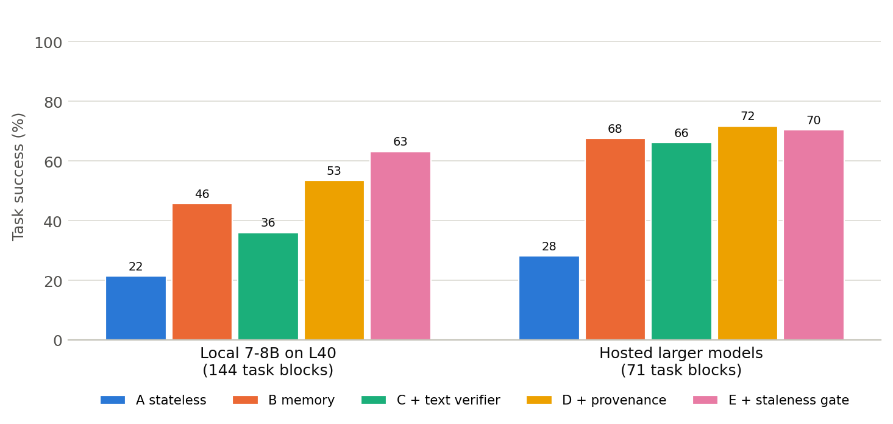

Table: Campaign 1 task success (recomputed from `raw_results/hpc_*_greedy_t1` and `raw_results/eval_*_t1`; complete task blocks only).

| Configuration | Local 7-8B (144 blocks) | Hosted larger models (71 blocks) |
|---|---|---|
| A stateless | 21.5% (16-29) | 28.2% (19-40) |
| B memory | 45.8% (38-54) | 67.6% (56-77) |
| C + text verifier | 36.1% (29-44) | 66.2% (55-76) |
| D + provenance | 53.5% (45-61) | 71.8% (60-81) |
| E + reliability gate | 63.2% (55-71) | 70.4% (59-80) |
| Harmful answers (A-E) | 0, 2, 0, 1, 0 | 0, 4, 1, 0, 0 |

Wilson 95% intervals in parentheses.

Table: Campaign 1 paired comparisons (percentage points, 95% task-bootstrap CI, exact McNemar p).

| Comparison | Local 7-8B | Hosted |
|---|---|---|
| B − A memory | +24.3 [+9.7, +38.2], p < 0.0001 | +39.4 [+25.0, +53.3], p < 0.0001 |
| C − B text verifier | −9.7 [−16.7, −4.2], p = 0.0001 | −1.4 [−6.0, +3.0], p = 1.0 |
| D − C provenance | +17.4 [+9.0, +25.7], p = 0.0002 | +5.6 [0.0, +12.7], p = 0.29 |
| E − D reliability gate | +9.7 [+0.7, +18.8], p = 0.034 | −1.4 [−6.7, +2.9], p = 1.0 |

## 10.2 Pilot findings

- Memory helped every model, with the largest gain on the hosted models, whose stronger tool use turned memory access into answers.
- On the local 7-8B models, the text-only verifier lowered success; provenance and the gate raised it. On the hosted models, none of B to E differed significantly. Their main limitation was *access*: gpt-oss-120b did not call memory at all in 13 of 24 memory-dependent runs per configuration.
- Stale records with the date only in metadata were solved 0 of 5 times by the hosted models without provenance and 3 of 5 with it; on local models, 0 of 12 without provenance and 9 of 12 with the gate.
- Cost (local, per task): latency rose by about a third from A to E, and tokens by 35% (3,248 to 4,371).

## 10.3 Pilot limitations

48 tasks; the hosted set truncated and dominated by two gpt-oss models (hosted Qwen has 7 blocks); one greedy trial per local model; and the harness and prompts had been tuned on 12 development tasks with the same templates. Every one of these was addressed or measured in campaign 2.

<!-- pagebreak -->

# 11. Fresh 96-task replication (campaign 2)

**Status: fresh validation.** 96 new tasks (16 per scenario), names from a disjoint slice of the name pool, frozen at 2026-11-12 04:54 UTC before any run. The original harness (v1) was run unchanged, so this is a clean replication.

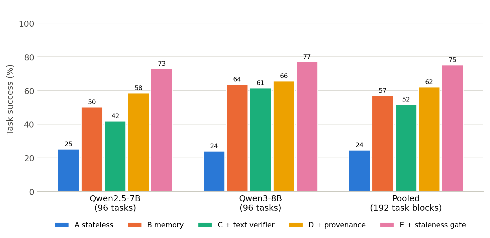

Table: Task success on the 96 fresh tasks, original harness (recomputed from `raw_results/c2_qwen25_7b_v1` and `c2_qwen3_8b_v1`).

| Configuration | Qwen2.5-7B (of 96) | Qwen3-8B (of 96) | Pooled (of 192) | Harmful, pooled |
|---|---|---|---|---|
| A stateless | 24 (25.0%) | 23 (24.0%) | 24.5% (19-31) | 0 |
| B memory | 48 (50.0%) | 61 (63.5%) | 56.8% (50-64) | 5 |
| C + text verifier | 40 (41.7%) | 59 (61.5%) | 51.6% (45-59) | 1 |
| D + provenance | 56 (58.3%) | 63 (65.6%) | 62.0% (55-69) | 2 |
| E + staleness gate | 70 (72.9%) | 74 (77.1%) | 75.0% (68-81) | 0 |

## 11.1 Denominators and uncertainty

- **Per model:** 96 tasks per configuration, one greedy run each. Each task counts 1.04 percentage points.
- **Pooled:** 192 task blocks per configuration. The bootstrap resamples the 96 *tasks*, carrying both models' results for each task together, because the two models answering the same task are not independent observations.
- **Paired:** every comparison is between configurations on the same tasks, so differences in task difficulty cancel. McNemar's test uses only the discordant tasks.

Table: Pooled paired comparisons, original harness (192 pairs).

| Comparison | Difference | 95% CI | Discordant (first only / second only) | McNemar p |
|---|---|---|---|---|
| B − A memory | +32.3 | +21.9 to +42.2 | 76 / 14 | < 0.0001 |
| C − B text verifier | −5.2 | −8.9 to −2.1 | 1 / 11 | 0.006 |
| D − C provenance | +10.4 | +5.2 to +15.6 | 29 / 9 | 0.002 |
| E − D staleness gate | +13.0 | +7.3 to +19.3 | 28 / 3 | < 0.0001 |
| E − B all three | +18.2 | +10.9 to +26.0 | 45 / 10 | < 0.0001 |
| E − A full system | +50.5 | +39.6 to +60.9 | 113 / 16 | < 0.0001 |

## 11.2 Per model

- **Qwen2.5-7B** shows every effect separately: memory +25.0 (p < 0.0001), verifier −8.3 (p = 0.008), provenance +16.7 (p = 0.0004), gate +14.6 (p = 0.0005).
- **Qwen3-8B** gains more from memory (+39.6) and from the gate (+11.5, p = 0.007), but its verifier penalty (−2.1, p = 0.63) and its provenance gain (+4.2, p = 0.48) are not significant on their own.

## 11.3 By scenario

Table: Pooled successes by scenario, original harness (of 32).

| Scenario | A | B | C | D | E |
|---|---|---|---|---|---|
| S1 context loss | 0 | 27 | 24 | 29 | 31 |
| S2 retrieval | 0 | 28 | 21 | 24 | 26 |
| S3 conflict | 0 | 12 | 13 | 19 | 25 |
| S4 stale | 0 | 4 | 4 | 10 | 25 |
| S5 unsupported | 27 | 16 | 16 | 16 | 16 |
| S6 tool failure | 20 | 22 | 21 | 21 | 21 |

Three patterns stand out. Stale records are where the gate matters most: 4, then 10, then 25 of 32. Conflicts improve steadily with provenance and the gate. And the unsupported-question row runs the other way: without memory 27 of 32 were correctly declined, with memory 16. That reversal is the abstention failure examined in Chapters 12 and 15.

## 11.4 What replicated

Every direction from campaign 1 held on twice as many fresh tasks. The weakest pilot result, the gate (p = 0.034 on 144 blocks), is now significant in each model separately. Provenance replicated on Qwen2.5-7B but not on Qwen3-8B alone.

<!-- pagebreak -->

# 12. Revised harness experiments (campaign 2)

**Status: fresh validation.** The revised harness was developed on the 12 development tasks only, frozen, and then run once on the same 96 fresh tasks as the original harness. That gives 480 paired runs per model.

## 12.1 The intervention

Harness v2 combines two changes, which were tested **together**:

1. **One repair turn.** If the agent's final message is not a `submit_answer` call or a parsable answer, the harness sends a fixed notice once: *"Your last message was not a submit_answer call. Call submit_answer now with your final status and value."*
2. **Two prompt rules**, added to the system prompt:
   - *Rule 6:* "If memory_search is available, search memory before deciding that a fact is unavailable and before giving up on a failing tool."
   - *Rule 7:* "Never repeat a tool call that already returned a valid result (a "not found" or empty result is valid). If neither memory nor the registry provides the requested fact, call submit_answer with status "abstain"."

A third variant, v1r (repair turn only), was designed to separate the two but was among the jobs that never started. **No claim below attributes the combined improvement to one change**, except where the logs show that one of them never fired.

Table: Task success, pooled over Qwen2.5-7B and Qwen3-8B (192 task blocks per cell).

| Configuration | Original harness | Revised harness |
|---|---|---|
| A stateless | 24.5% | 29.2% |
| B memory | 56.8% | 81.8% |
| C + text verifier | 51.6% | 70.3% |
| D + provenance | 62.0% | 75.5% |
| E + staleness gate | 75.0% | 92.2% |

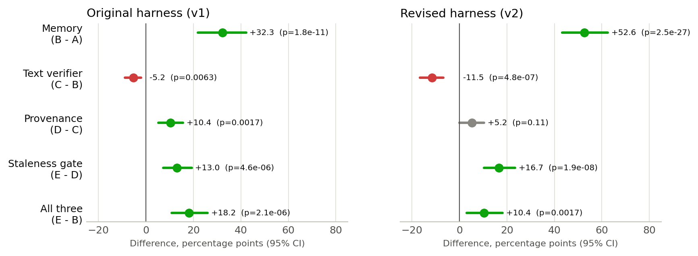

## 12.2 Overall effect

Table: Revised minus original harness, all five configurations, 480 paired runs per model.

| Model | Original | Revised | Difference (95% CI) | Improved / worsened | McNemar p |
|---|---|---|---|---|---|
| Qwen2.5-7B | 49.6% | 65.4% | +15.8 (+8.8 to +23.1) | 105 / 29 | < 0.0001 |
| Qwen3-8B | 58.3% | 74.2% | +15.8 (+9.8 to +22.3) | 85 / 9 | < 0.0001 |

## 12.3 What changed, and why

Table: Mechanism counts, original → revised harness (480 runs per model unless stated).

| | Qwen2.5-7B | Qwen3-8B |
|---|---|---|
| Format errors + step-limit failures | 104 → 21 | 117 → 7 |
| Unanswerable questions correctly declined, config E (of 16) | 15 → 16 | **1 → 16** |
| Memory consulted in S1-S4, configs B-E (of 256) | 208 → 232 | 256 → 256 |
| Fell back to memory when the tool stayed down (of 16) | 1 → 12 | 0 → 6 |
| False conflict flags | 14 → 34 | 16 → 30 |
| Harmful answers | 1 → 7 | 7 → 3 |
| Repair turns used | — → 14 | — → **0** |

**Why Qwen3-8B improved: the prompt rules.** The repair turn never fired for Qwen3-8B; it always ended with a valid `submit_answer` call. Its entire +15.8 points therefore came from the two rules. Rule 7 gave it a stopping condition: under v1 it had searched memory and the registry in alternation until the step limit (89 step-limit runs); under v2 it abstained, and unanswerable questions in configuration E went from 1 to 16 of 16.

**Qwen2.5-7B: both parts were active.** The repair turn fired 14 times and all 14 ended correct; 105 runs improved in total. The rules raised memory consultation (208 → 232 of 256) and memory fallback after tool failure (1 → 12 of 16).

**Why the repair turn did not cause the new wrong answers.** Qwen2.5-7B's harmful answers rose from 1 to 7. None of the seven followed a repair turn (the 14 repaired runs all ended correct). Six were wrong values on context-loss tasks in configuration B, and four of those six are the *12500.00 cases*. On four different tasks the model submitted the identical value 12500.00 **without calling any tool**, citing `registry_lookup` and `calculator` as its evidence. The correct values were 19023.33, 45762.50, 164825.00 and 40494.12. The same invented draft appeared in configurations C, D and E, and there **the verifier rejected it all 12 times** (verdict UNSUPPORTED, so the final answer became an abstention). This is the one clear case in the study where the text-only verifier did its job: an answer with no evidence at all is easy to recognise as unsupported. A plausible, unproven reading is that rule 6 ("search memory before deciding a fact is unavailable") primed the model to describe a search instead of performing one.

**Why false conflict flags increased.** Both models roughly doubled their false conflict flags. They now search memory more often, so they see more pairs of records for the same attribute, typically an older and a newer value. Pooled over both models, the revised harness produced 22, 22 and 20 false conflicts in B, C and D, and **none in E**. Seeing the dates (D) was not enough; the model still read an update as a contradiction. Only the gate, which labels the older record *superseded* in code, removed the error.

## 12.4 Do the component effects survive the fix?

Table: Pooled paired comparisons, revised harness (192 pairs).

| Comparison | Difference | 95% CI | McNemar p |
|---|---|---|---|
| B − A memory | +52.6 | +43.2 to +62.5 | < 0.0001 |
| C − B text verifier | −11.5 | −16.7 to −6.8 | < 0.0001 |
| D − C provenance | +5.2 | 0.0 to +10.4 | 0.11 |
| E − D staleness gate | +16.7 | +10.4 to +23.4 | < 0.0001 |

The verifier penalty and the gate benefit are robust to the harness. The provenance step is not: once the agent searches properly, showing dates helps less on its own, and the gate, which uses the dates in code, does the work. Stale-record tasks in configuration E: 32 of 32.

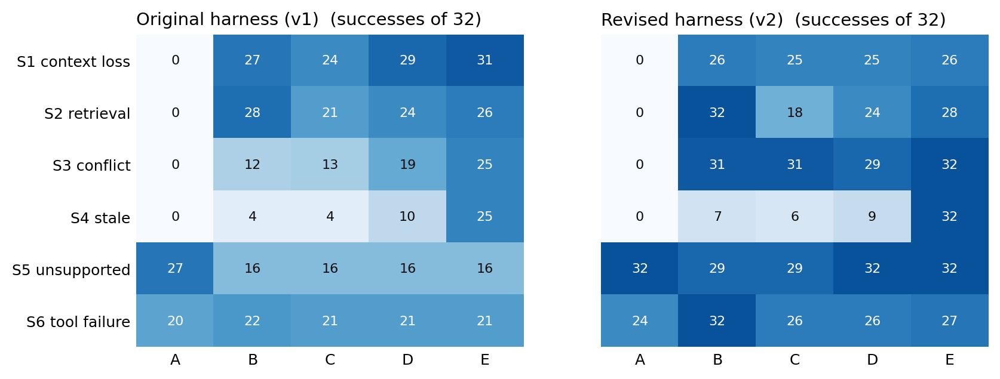

<!-- pagebreak -->

# 13. Model-size comparison (campaign 2, exploratory)

**Status: exploratory.** One model family (Qwen2.5-Instruct), one serving stack (Hugging Face transformers, bfloat16, greedy, on an L40), one trial per cell, 96 fresh tasks. The 7B runs are the same runs as in Chapters 11 and 12.

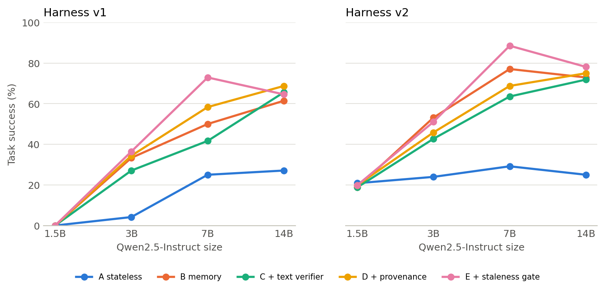

Table: Successes of 96 per configuration (recomputed from `raw_results/c2_qwen25_{1p5b,3b,7b,14b}_{v1,v2}`).

| Size | Harness | A | B | C | D | E | Format + step failures (of 480) | Memory consulted, S1-S4 (of 256) |
|---|---|---|---|---|---|---|---|---|
| 1.5B | v1 | 0 | 0 | 0 | 0 | 0 | 480 | 0 |
| 1.5B | v2 | 20 | 18 | 18 | 19 | 19 | 8 | 0 |
| 3B | v1 | 4 | 32 | 26 | 33 | 35 | 238 | 164 |
| 3B | v2 | 23 | 51 | 41 | 44 | 49 | 35 | 224 |
| 7B | v1 | 24 | 48 | 40 | 56 | 70 | 104 | 208 |
| 7B | v2 | 28 | 74 | 61 | 66 | 85 | 21 | 232 |
| 14B | v1 | 26 | 59 | 63 | 66 | 62 | 113 | 236 |
| 14B | v2 | 24 | 70 | 69 | 72 | 75 | 66 | 232 |

Table: Paired effect of each component in percentage points (original / revised harness). * p < 0.05.

| Size | Memory B − A | Text verifier C − B | Provenance D − C | Gate E − D |
|---|---|---|---|---|
| 1.5B | 0.0 / −2.1 | 0.0 / 0.0 | 0.0 / +1.0 | 0.0 / 0.0 |
| 3B | +29.2* / +29.2* | −6.2* / −10.4* | +7.3 / +3.1 | +2.1 / +5.2 |
| 7B | +25.0* / +47.9* | −8.3* / −13.5* | +16.7* / +5.2 | +14.6* / +19.8* |
| 14B | +34.4* / +47.9* | +4.2 / −1.0 | +3.1 / +3.1 | −4.2 / +3.1 |

## 13.1 Reading the sweep size by size

**1.5B: never uses memory.** Under v1, every one of 480 runs is a format error. In the transcripts inspected, the model emits well-formed tool calls (for example two `registry_lookup` calls) and then ends with the bare word "abstain" instead of a `submit_answer` call. Under v2 the repair turn fixes the format, but the model called `memory_search` in **0 of 256** memory-dependent runs. Its ~20% comes from tasks where abstaining is correct. It asserted 24 wrong values, all after the repair turn had asked it for an answer.

**3B: gains from memory only.** Memory adds 29 points under both harnesses; the verifier subtracts 6 to 10; provenance and the gate add nothing significant. The gate fails to transfer: stale tasks in configuration E are solved 2 of 16 times. Its harmful counts (24 under v1, 37 under v2) overstate the problem: 15 and 20 of them are `answer` statuses with an empty value. Genuinely wrong asserted values: 9 and 17.

**7B: every component pays off.** This is the only size at which memory, provenance (under v1) and the gate are all significant, and it produced the best configuration of the study: **85 of 96 (88.5%)**, revised harness, configuration E.

**14B: large memory gain, little beyond.** Memory adds 34–48 points, and the remaining components are not significant overall. Two findings from the transcripts make "14B does not need them" too strong:

- *Calculator loops.* The 14B model repeatedly called the calculator with `round(570700 / 30, 2)` and with Python formatting such as `(570700 / 30):.2f`. The tool evaluates plain arithmetic only and rejects both. In 21 (v1) and 19 (v2) of its step-limit runs it had done this.
- *A switch to Thai.* In 268 (v1) and 274 (v2) of its 480 runs, the 14B model wrote part of its free-text reasoning in Thai, while still producing well-formed English tool calls. For example, it narrated a registry lookup as *"คณะกรรมการทำงานต่อไปด้วยการค้นหาขนาดทีมของโครงการ Qualom"* (roughly, "the working committee continues by searching for the team size of project Qualom"). Of its format errors, 71 of 86 (v1) and 43 of 43 (v2) are runs containing substantial Thai text; in the revised-harness runs, the final message itself was Thai instead of an answer. No other model did this. Whether it is model behaviour under this prompt and greedy decoding, or an interaction with the serving stack (transformers 5.22, bfloat16), **is unknown and was not tested**.

Where the gate could act, it still helped the 14B model: stale tasks went from 8 to 12 (v1) and from 10 to 14 (v2) of 16 between D and E. Under v1 it hurt conflicts (14 to 7 of 16).

## 13.2 What the sweep shows, and does not

- **Memory dependence starts between 1.5B and 3B.** Below that, the model does not use the tool.
- **The reliability components follow an inverted U:** no value at 1.5B and 3B, the largest value at 7B, little marginal value at 14B on this tool set.
- **It does not show** a general law about model size: one family, one trial, one calculator implementation, and an unexplained language anomaly at 14B. The safest statement is *"in this family and setup, the components helped most at 7B."*

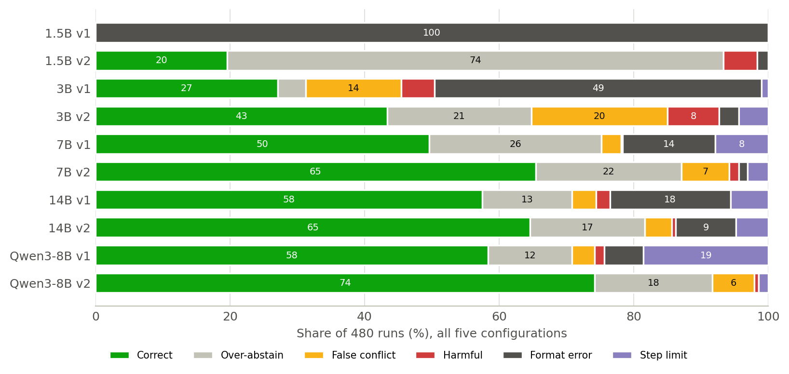

<!-- pagebreak -->

# 14. Retrieval scaling results

## 14.1 Retrieval only

Chapter 6 gives the full table. In one line: with natural-language queries, AGENTRUN's hash retriever puts the gold record in the top 4 for **0.46** of queries at 2,000 records, **0.18** at 10,000 and **0.05** at 100,000. BM25 stays at 0.999–1.000, MiniLM at 0.957–0.999 and bge-small at 0.990–1.000.

## 14.2 Retrieval inside the agent (campaign 2, exploratory)

Qwen2.5-7B, revised harness, memory scenarios S1–S4, configurations B, D and E (64 tasks per configuration, 192 paired runs). Every task's memory was padded with the same 2,000 background records about other fictional projects. The retriever was swapped while everything else stayed fixed.

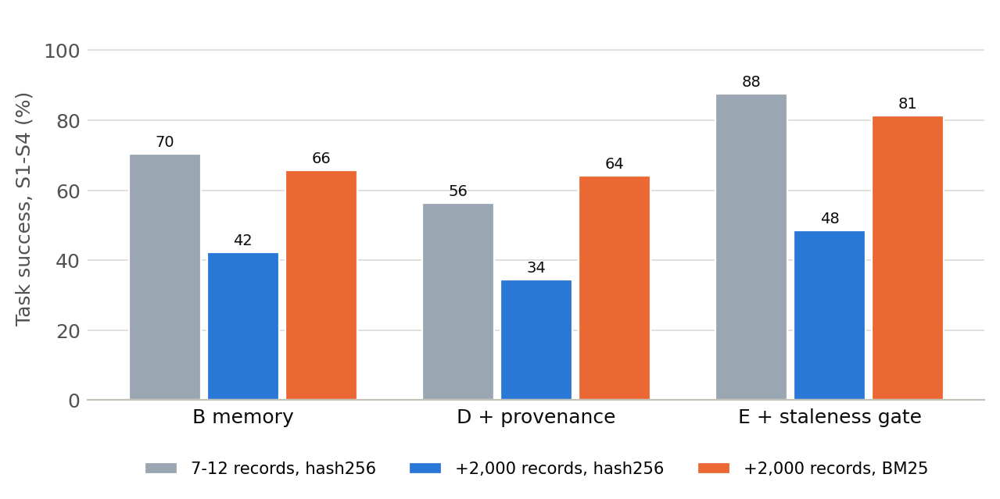

Table: Retrieval inside the agent (recomputed from `raw_results/c2_qwen25_7b_v2*`).

| Store | Success B / D / E (of 64) | Overall (of 192) | Gold record found by the agent's queries | Harmful |
|---|---|---|---|---|
| 7-12 records, hash256 | 45 / 36 / 56 | 137 (71.4%) | 1.00 | 7 |
| + 2,000 records, hash256 | 27 / 22 / 31 | 80 (41.7%) | 0.76 | 10 |
| + 2,000 records, BM25 | 42 / 41 / 52 | 135 (70.3%) | 1.00 | 6 |

- Hash256 with 2,000 records versus no padding: **−29.7 points** (95% CI −39.1 to −20.8; 6 runs better, 63 worse; p < 0.0001).
- BM25 versus hash256, both at 2,000 records: **+28.6 points** (+19.8 to +38.0; 64 better, 9 worse; p < 0.0001).

## 14.3 Why the two measurements differ

Retrieval-only recall at 2,000 records was 0.46 for natural-language queries, but inside the agent the agent's own queries retrieved 76% of the gold records (recall over all of a run's searches, averaged over runs). The agent writes its own, shorter queries, such as "Project Skofiom deadline", and keyword-style queries score much higher on the hash retriever (0.90 recall@4 at 2,000 records in the retrieval-only test). It can also search more than once. End-task success then falls further than recall alone, because a missed record turns into an over-abstention or a false conflict, and a near-miss record can turn into a wrong answer.

**Limitations.** The padding records are templated and similar to the task records, which is hard for a lexical hash and easy for BM25. The dense retriever inside the agent was among the jobs that did not run. One model, one trial.

<!-- pagebreak -->

# 15. Failure analysis

Every example below is a real run. The task id, configuration and run directory identify the transcript in the study folder's `raw_results/`. Chapter 7 defines the outcome labels.

## 15.1 Correct answers rejected by the verifier

- **What happened.** Campaign 1, Qwen2.5-7B, configuration C, task `eval-S1_context_loss-00`. The agent found the budget and team size in memory, divided, and drafted the correct 17185.29. The verifier replied UNSUPPORTED: *"The evidence does not provide the required information for Project Driocist, instead providing data for other projects."* Final outcome: over-abstention.
- **What it should have done.** Accepted the draft. The evidence contained both required records.
- **Why it failed.** The evidence was the right records mixed with distractors and a registry "not found". Without ids, dates or sources, a same-model verifier read the mixture as lack of support.
- **Component responsible.** The text-only verifier.
- **Evidence.** In campaign 1 the local models' text-only verifier made 14 wrong rejections and 2 correct ones. On the fresh tasks: 11 wrong and 4 correct (v1), 22 wrong and 7 correct (v2).
- **Attempted fix and result.** Provenance in the evidence (D): precision rose (7/8 in campaign 1; 4/10 and 11/23 on fresh tasks), but about half of its rejections on fresh tasks are still wrong. Partly fixed.

## 15.2 Stale memory

- **What happened.** Campaign 1, task `eval-S4_stale-03`: *"What is the delivery deadline for Project Traekaelt?"* Memory: 2027-03-13 (recorded 2026-07-31) and 2027-05-12 (recorded 2026-05-23). gpt-oss-20b, configuration B, answered 2027-05-12 with the note *"Two dates found; 2027-05-12 is later."* The adapter model in configuration D, *with* the recording dates visible, gave the same answer, citing the older record as "most recent"; its verifier agreed: *"The most recent deadline for Project Traekaelt is 2027-05-12, as recorded in meeting notes."*
- **What it should have done.** Answered 2027-03-13, the value of the more recently recorded record.
- **Why it failed.** The values are dates, so "most recent" was read as "latest value". Generator and verifier share the confusion.
- **Component responsible.** The model's reasoning over provenance; the same-model verifier could not catch it.
- **Attempted fix and result.** The deterministic gate (E) labels the older record *superseded*. Stale tasks pooled: 4 of 32 (B) → 25 of 32 (E) under v1, 32 of 32 under v2. Fixed at 7-8B; not at 3B (2 of 16).

## 15.3 False conflict detection

- **What happened.** Campaign 1, gpt-oss-20b, configuration C, task `eval-S4_stale-01` (who leads Project Quoucoust; date only in metadata). It answered *conflict*: *"Two conflicting records found, no way to determine most recent."*
- **Why.** In configuration C the dates are hidden, so from what the model could see, this *was* a conflict. The failure is in what it was shown, not in its reasoning.
- **Component responsible.** Missing provenance.
- **Evidence.** False conflicts roughly doubled under the revised harness (14 → 34 and 16 → 30), because the models now search more and see more same-attribute records. Pooled, they occurred 22, 22 and 20 times in B, C and D, and never in E.
- **Attempted fix and result.** Provenance alone (D) did not remove them; the gate (E) did. Fixed by the gate; the revised harness made the failure more frequent elsewhere.

## 15.4 Unsupported values

- **What happened.** Campaign 2, Qwen2.5-7B, revised harness, configuration B, tasks `eval2-S1_context_loss-00`, `-06`, `-08`, `-12`. On each, the model submitted 12500.00 **without calling any tool**, citing `registry_lookup` and `calculator` as evidence. The correct values were 19023.33, 45762.50, 164825.00 and 40494.12.
- **What it should have done.** Searched memory, found the budget and team size, and computed.
- **Why.** Unknown. The identical number on four tasks indicates invention, not misreading. A plausible but unproven reading is that the new rule 6 primed the model to describe a search instead of performing one.
- **Component responsible.** Generation; none of the memory components can see a search that did not happen.
- **Attempted fix and result.** The verifier (C, D, E) rejected the same invented draft in all 12 runs where it was checked. The answer was withdrawn, but not corrected.
- **Related.** At 1.5B under the revised harness, the model asserted 24 wrong values after the repair turn asked it for an answer.

## 15.5 Repeated retrieval loops

- **What happened.** Campaign 2, Qwen3-8B, original harness, configuration E: *"Who is the lead of Project Caskaen?"* (unanswerable by design). The model called `registry_lookup` (not found), then `memory_search` ("Project Caskaen lead"), which returned records about the project's other attributes. It repeated the pair three times, used all six steps, and never answered.
- **What it should have done.** Abstained after one search of each source.
- **Why.** Nothing in the original prompt said when to stop. A "not found" invited another attempt.
- **Evidence.** Unanswerable questions correctly declined by Qwen3-8B: 15 of 16 without memory (A), 1 of 16 in E; 15 of the E failures were step-limit runs. It made no unsupported claims. **This is looping, not fabrication.**
- **Attempted fix and result.** Rule 7 (never repeat a call that returned a valid result; abstain if neither source has the fact): 16 of 16 in every configuration. Fixed.

## 15.6 Maximum-step termination

The step limit (6) is the safety net under several failures above. Under the original harness on fresh tasks it ended 38 Qwen2.5-7B runs, 89 Qwen3-8B runs and 27 Qwen2.5-14B runs. The causes differ: alternating searches (Qwen3-8B), unsupported calculator syntax (14B; Section 15.9), and repeated "not found" retries. The revised harness reduced step-limit failures to 15 (Qwen2.5-7B) and 7 (Qwen3-8B) but hardly at 14B (23), because the calculator problem is not a prompting problem.

## 15.7 Over-abstention

- **What happened.** Campaign 1, gpt-oss-120b, configuration B, `eval-S2_retrieval-01` (team size of Project Faedroult; the record is in memory). It called `registry_lookup`, got "not found", and abstained: *"No registry entry found for team size of Project Faedroult."* It never called `memory_search`, and it behaved the same in B, C, D and E.
- **Why.** Memory was available but not considered a source worth checking.
- **Evidence.** gpt-oss-120b consulted memory in only 11 of 24 memory-dependent runs per configuration. On fresh tasks, over-abstention is Qwen2.5-7B's most common non-correct outcome (123 of 480 runs under v1).
- **Attempted fix and result.** Rule 6 raised memory consultation for Qwen2.5-7B (208 → 232 of 256) and memory fallback after tool failure (1 → 12 of 16). Not tested on gpt-oss.

## 15.8 Model-specific tool-call format failures

- **Qwen2.5-7B (original harness):** complete answers written as plain text, for example *"status: conflict / value: / evidence: ["memory_search", "memory_search"] / note: "Memory search returned conflicting results…""*, instead of a `submit_answer` call. These count as format errors under strict scoring.
- **Qwen2.5-1.5B (original harness):** valid tool calls, then the bare word "abstain" as the final message, in all 480 runs.
- **Qwen2.5-14B:** format errors in runs with substantial Thai text (71 of 86 under v1, all 43 under v2).
- **V2 adapter:** 33 of 48 campaign-1 runs in configuration A were format errors, typically a bare "status: abstain" line. The adapter was trained on four different tools and a different system prompt.
- **Fix and result.** The repair turn and the rules cut format plus step-limit failures from 104 to 21 (Qwen2.5-7B) and 117 to 7 (Qwen3-8B). The 1.5B model's format was fixed but its behaviour was not. The 14B Thai output persists.

## 15.9 Calculator schema mismatch

- **What happened.** Campaign 2, Qwen2.5-14B, revised harness, configuration B, `eval2-S1_context_loss-00`. After finding the budget (570700) and team size (30) in memory, it called `calculator("(570700 / 30):.2f")`, then `calculator("round(570700 / 30, 2)")` four times. Each call failed, and it ran out of steps. In campaign 1, Qwen3-8B tried `calculator("20270313 < 20270512")` to compare two dates.
- **Why.** The tool's description ("Evaluate a basic arithmetic expression") does not say that functions and comparisons are unsupported, and the error message did not make the model change approach.
- **Component responsible.** The tool interface, not memory.
- **Fix.** None attempted. A clearer schema or a `round` function would remove it.

## 15.10 Retrieval failure at scale

- **What happened.** With 2,000 background records, the hash retriever's results contained the gold record for only 76% of the agent's searches, and end-task success fell from 71.4% to 41.7%.
- **Component responsible.** The retriever.
- **Fix and result.** BM25 restored 70.3% with full gold recall. Dense retrieval inside the agent was not run.

## 15.11 Summary

Table: Failure modes, responsible component and status.

| Failure | Responsible component | Fix tried | Worked? |
|---|---|---|---|
| Correct answers rejected | text-only verifier | provenance in evidence | partly |
| Stale value asserted | model reasoning over dates | deterministic gate | yes at 7-8B; not at 3B |
| False conflict | update read as contradiction | provenance, then gate | gate yes (0 in E); provenance alone no; v2 increased it in B-D |
| Unsupported invented value | generation | verifier | withdrawn, not corrected |
| Search loops, no abstention | no stopping rule | prompt rule 7 | yes |
| Memory not consulted | agent policy | prompt rule 6 | improved (Qwen2.5-7B) |
| Format errors | output format compliance | repair turn | yes except 1.5B and 14B |
| Calculator loops | tool interface | none | — |
| Retrieval at scale | hash retriever | BM25 | yes |

<!-- pagebreak -->

# 16. HPC execution and computational environment

## 16.1 From Colab to institutional HPC

The fine-tuning study ran on a free Colab T4 (16 GB): one model at a time, sessions that expire, a public tunnel to a notebook server, and live web APIs. That is enough to train a QLoRA adapter, but not to run thousands of controlled, logged, reproducible agent runs across several models. The SIT HPC provided the scale and the control.

Table: The SIT HPC environment, as verified on 11-12 November 2026.

| Item | Value |
|---|---|
| Login node | `<cluster-login>` (<cluster-login>); login only, no GPU; not used for compute |
| Compute node | `<compute-node>`: 2 × NVIDIA L40 (44.6 GiB visible to PyTorch each), 2 × Intel Xeon Gold 6542Y (96 logical CPUs), 503 GiB RAM (515,705 MB configured) |
| Operating system | Ubuntu 24.04 (inferred from the NVIDIA kernel module's compiler string) |
| Scheduler | Slurm, partition `gpu-nodes`, no time limit, `--gres=gpu:1`; accounting disabled (no `sacct`) |
| Python | 3.12.3 with a user-space virtual environment: torch 2.15.0 (CUDA 13.2 build), transformers 5.22.2, peft 0.21.2, sentence-transformers 6.2.0 |
| Models | Qwen2.5-7B-Instruct and Qwen3-8B from the cluster's model cache; Qwen2.5 1.5B, 3B and 14B downloaded for the size sweep |
| Known issue | `nvidia-smi` fails (driver/library mismatch) but CUDA works; GPU utilisation was therefore not recorded |

## 16.2 How the jobs were run

- **Slurm batch jobs, not interactive sessions.** Each experiment is a self-contained `.sbatch` script that activates the environment, sets offline model loading, runs one experiment and appends its exit code to a manifest.
- **Job arrays** with a concurrency cap of two (`--array=0-20%2`): one GPU per job, both L40s busy, never more.
- **Resumable runs.** Every run appends one JSON line per (task, configuration) and skips pairs already present, so a restarted job never repeats completed work. A `DONE` file marks completion.
- **Full logs.** Slurm stdout and stderr per job, a run manifest (model, adapter hash, seed, decoding, package versions, harness hash) and the raw transcripts.
- **Pilots first.** A diagnostic job, a CUDA test and a pilot on the development split preceded each campaign.

## 16.3 Campaign 2 status

Table: Slurm array 4148 (21 jobs). Exit codes from the job manifests in `hpc/from_cluster/manifests/` and logs in `logs/hpc/`.

| Index | Experiment | Status |
|---|---|---|
| 0 | Qwen2.5-7B, harness v1, 96 tasks × 5 configs | completed, exit 0 |
| 1 | Qwen3-8B, harness v1 | completed, exit 0 |
| 2 | Qwen2.5-7B, harness v2 | completed, exit 0 |
| 3 | Qwen3-8B, harness v2 | completed, exit 0 |
| 4 | Base model: original 23 tasks and v2 dev split, budgets 3 and 6, three sampled repeats | completed, exit 0 |
| 5 | V2 adapter: the same | completed, exit 0 |
| 6-11 | Qwen2.5 14B, 3B, 1.5B, harness v1 and v2 | completed, exit 0 |
| 12 | hash256 + 2,000 records | completed, exit 0 |
| 13 | BM25 + 2,000 records | completed, exit 0 |
| 14 | dense retriever + 2,000 records | **never started** |
| 15-16 | repair-only harness (v1r), both models | **never started** |
| 17-18 | V2 adapter on the memory benchmark (v1, v2) | **never started** |
| 19-20 | revised harness at T = 0.7, two seeds | **never started** |

Jobs 0–13 ran between 04:58 and 08:42 UTC on 12 November. Afterwards the login node, which runs the Slurm controller, stopped responding, and `squeue` on the compute node reported "Unable to contact slurm controller". Jobs 14–20 were never dispatched. This was observed at 12:08 UTC by a recovery session, which also reports a backup on the cluster; at 13:50 UTC neither cluster address answered from the laptop, so neither the controller state nor the backup could be re-checked. All results of jobs 0–13 are on the laptop and committed, except the per-task file of one v2-dev adapter run, whose summary survives in its job log.

Totals on the HPC over the two campaigns: **6,624 agent runs** (1,440 in campaign 1 and 5,184 in campaign 2) plus 450 task evaluations of AGENTRUN's own benchmarks, development-split pilots before each campaign, and the retrieval-only benchmark (96 result rows over 3 seeds and 3 store sizes).

<!-- pagebreak -->

# 17. Research contributions and limitations

## 17.1 What the project contributes

Table: Contributions by kind, with how strong the evidence is.

| Kind | Contribution | Strength |
|---|---|---|
| Engineering | A controlled, fully logged, resumable agent-evaluation harness with five switchable reliability components, scripted tool failures and per-task isolated memory; a local-GPU client using AGENTRUN's own parser; Slurm job arrays with resumption | Working, tested (9 harness tests), used for about 6,600 HPC runs |
| Methodological | Frozen, hashed, fictional-entity benchmarks with an automated 77-check leakage and isolation audit; scoring that separates task success from harmful assertions; paired task-level analysis with task-clustered intervals; replication on a fresh split before any claim | Reusable; applied to two splits |
| Empirical | Memory helps every model from 3B up; a same-model text-only verifier lowers success; provenance plus a deterministic gate fix stale records; memory can suppress abstention, and a stopping rule restores it | Replicated on fresh tasks; p < 0.01 for the main effects |
| Empirical (exploratory) | The value of reliability components depends on capacity non-monotonically (inside one family); hash retrieval collapses end-to-end at 2,000 records and BM25 restores it; the fine-tuned adapter's benchmark gain does not transfer | One trial, one family, one setup |
| Project integrity | The earlier fine-tuning result is re-examined with a matched client: its 23/23 reproduces, and its advantage disappears on fresh tasks | Five matched runs; 55 fresh tasks |

## 17.2 Where novelty is not established

The individual mechanisms are not new. Last-write-wins and conflict flags are standard database ideas. Stale and conflicting agent memory is studied directly by STALE (2026) and by the conflict-resolution split of MemoryAgentBench (Hu et al., 2025), where a frozen "newest statement wins" rule already answers most questions (Pakhomov et al., 2026). Self-verification without external feedback is known to fail often (Huang et al., 2023; Kamoi et al., 2024). Temporal memory architectures exist (Zep; Governed Persistent Memory). The related-work check was by title and abstract only.

The defensible contribution is narrower: **a controlled, paired measurement of which reliability component helps, by how much, at which model size, inside a multi-tool agent that also has to decide when to search, when to stop and how to recover from tool failures**, with a negative result for verification without provenance and a measured fix for the abstention failure. Whether that is a publishable contribution depends on whether it holds outside synthetic, keyed memories.

## 17.3 Limitations

1. **Synthetic benchmark.** Facts come from six sentence templates with clean entity–attribute keys. This favours lexical retrieval and makes the gate easy to implement. Real memories are free text, written by the agent, with keys that must be inferred.
2. **The author designed both method and benchmark.** The scenarios were built to exercise the components being tested.
3. **Sample size.** 96 tasks per model per configuration on the fresh split; scenario cells of 16 per model. Harmful answers are rare (1 to 7 per 480 runs at 7–8B), so differences in them cannot be tested.
4. **Statistical dependence.** Pooled results share tasks across models; configurations share tasks; the sampled repeats share tasks. All analyses pair on tasks and resample tasks, but the effective sample is the number of tasks, not the number of runs.
5. **Model families.** The local results are Qwen only (Qwen2.5 at four sizes, Qwen3-8B). The hosted gpt-oss results are from a truncated campaign.
6. **One trial per cell** for every campaign-2 result; the sampled repeats of the revised harness did not run.
7. **The prompt is part of the system.** The two rules that fixed abstention are prompt text; a different prompt could move every number.
8. **Incomplete HPC campaign.** Dense retrieval inside the agent, the repair-only variant, the adapter on the memory benchmark and run-to-run spread under v2 are missing.
9. **No sealed-test result.** The 130-task sealed split of benchmark v2 has never been opened. Nothing in this dossier is a final held-out test result.
10. **The 14B anomaly.** The switch to Thai is unexplained and may reflect the serving stack; the 14B results carry that caveat.
11. **Memory writing was not tested.** The harness writes the records; the agent never does.
12. **Generalisation.** None of this is shown on real user memories, long-horizon multi-session tasks, or non-synthetic tools.

<!-- pagebreak -->

# 18. Future research directions

Ranked by scientific value per unit of effort.

1. **Realistic, agent-written memory (highest value).** Multi-session tasks in which the agent writes its own free-text memories, with one deliberately wrong record and natural updates. This tests whether the gate's benefit survives when keys must be extracted, and it is the experiment that decides whether the results generalise.
2. **Evidence-sufficiency-aware abstention.** Replace the prompt-level stopping rule with an explicit estimate of whether the retrieved evidence can support any answer, for example a calibrated "sufficient / insufficient / conflicting" classifier over the retrieved set. Measure abstention precision and recall, not only task success.
3. **Bounded memory-search policies.** A search budget, query reformulation and de-duplication of repeated calls, evaluated against the loop and over-abstention failures in Chapter 15.
4. **Temporal validation beyond last-write-wins.** Validity intervals, source reliability and explicit retractions, compared with the simple gate on tasks where the latest record is *not* the right one.
5. **Conflict resolution rather than conflict flagging.** When should an agent ask the user, prefer a more reliable source, or report both values?
6. **Capacity-dependent policies.** The sweep suggests small models need deterministic support (the gate) while large ones mainly need access. Test whether choosing components by model size beats a fixed pipeline, across at least two families.
7. **Retrieval at scale inside the agent.** Complete the dense-retriever run, add hybrid BM25 + dense retrieval, and measure stale exposure end to end at 10,000 and 100,000 records.
8. **A realistic long-horizon benchmark.** Bring the scenarios into an established setting (LongMemEval, MemoryAgentBench, STALE) to compare with published systems.
9. **External validation.** Run the sealed 130-task test split once, with a registered analysis plan, and invite an independent annotator for the pattern-graded items.
10. **A rigorous evaluation of fine-tuning.** Train adapters with a held-out design (failure-informed versus size-matched random data, several seeds), evaluate on fresh tasks only, and finally re-run V1 under a matched client.

<!-- pagebreak -->

# 19. MITACS interview preparation

## 19.1 Thirty-second introduction

AGENTRUN is a multi-tool LLM agent runtime I built: a model calls tools such as search, weather and a calculator through MCP, and keeps a persistent memory across sessions. I asked whether that memory actually makes the agent more *reliable*, not just more capable. On our institute's GPU cluster I ran controlled ablations: the same tasks with no memory, with memory, with a verifier, with provenance and with a rule-based staleness check, across models from 1.5 to 14 billion parameters. Memory roughly doubles task success. A verifier that cannot see where evidence came from makes things worse. And memory can stop an agent from saying "I don't know". Provenance, a simple staleness rule and two prompt rules fix most of that.

## 19.2 Two-minute explanation

I started with QLoRA fine-tuning of Qwen2.5-7B for tool use, on a 23-task benchmark and a free Colab GPU. That phase taught me to distrust my own numbers. One drop in performance was partly an artefact of the parser and evaluation client, and a later perfect score came from an adapter whose extra training data had been designed from failures on those same 23 tasks. When I re-ran it on our cluster with a matched client, it scored 23 of 23 again, but on 55 fresh tasks it was no better than the base model.

The memory layer had never been tested, so I built an experiment around it. There are six scenarios: lost context, retrieval among distractors, conflicting records, stale records, unanswerable questions and tool failures. There are five configurations that each add one component. Scoring separates "solved the task" from "asserted something false". The tasks use invented names, are frozen before any run and pass an automated leakage audit.

On 96 fresh tasks with Qwen2.5-7B and Qwen3-8B, memory raised success from 25% to 57%. A verifier that saw only text cut it to 52%, because it rejected correct answers. Adding dates and sources, then a rule that marks superseded records, took it to 75%, and on stale records from 4 to 25 out of 32. The most interesting failure was that with memory, Qwen3-8B stopped abstaining. It searched in a loop until it ran out of steps. Two prompt rules fixed that and lifted the full system to 92%. Finally, inside one model family, these components helped most at 7B: the 1.5B model never even uses memory, and the 14B model needs little beyond it.

## 19.3 Five-minute technical explanation

- **Question.** Does persistent memory make a multi-tool agent more reliable, which reliability mechanisms matter, and how does that depend on model size?
- **Why it matters.** Memory solves lost context but introduces stale, conflicting and irrelevant evidence. A capable agent can become a confidently wrong one.
- **Design.** A paired ablation. Each task runs under A stateless, B memory, C + a same-model verifier, D + provenance, E + a deterministic gate that labels records current, superseded or conflicting. Only the prompt reaches the model; tasks use fictional entities; each task has its own memory store; ground truth stays with the scorer. An outcome taxonomy separates correct, safe misses (over-abstention, false conflict) and harmful assertions (wrong, stale, unsupported, arbitrary pick).
- **Execution.** Slurm job arrays on two L40s; about 6,600 agent runs over two days; a 48-task pilot, then a fresh 96-task replication.
- **Findings.** Memory +32 points; text verifier −5 (−12 with the revised harness); provenance +10; gate +13 (pooled, 192 pairs, all p ≤ 0.006). Stale records 4 → 25 of 32. Memory suppressed abstention; a stopping rule restored it and added 16 points on both models.
- **Mechanisms.** The verifier lacks provenance and shares the generator's blind spots. Models read "most recent" as "latest date". Without a stopping rule, a "not found" invites another search.
- **Capacity.** An inverted U for the reliability components inside Qwen2.5: none at 1.5B or 3B, large at 7B, small at 14B, with two caveats at 14B (calculator syntax loops and an unexplained switch to Thai).
- **Next.** Agent-written free-text memories with a deliberately wrong record, explicit evidence-sufficiency estimation for abstention, and a second model family.

## 19.4 Ten-minute deep technical walkthrough (outline)

1. **The system (1.5 min).** The Gemini agent loop; MCP over stdio for four tools; memory as a hashed 256-dimensional bag of words with cosine top-3; the write-back of the agent's own answers. Point out what it lacks: no provenance, no verification, no conflict handling. (Diagram A.)
2. **The fine-tuning history (1.5 min).** QLoRA r = 16 on attention projections, 10.1M trainable parameters; Base 22 → V1 18 → E4 18 → V2 23 of 23; why E4 is confounded and V2 is adapted to its benchmark; the client-matched re-run (23/23 five times, no gain on 55 fresh tasks).
3. **The harness (1.5 min).** Diagram B; the five configurations; the six scenarios and how each difficulty is built into the fixture; the `submit_answer` contract; the outcome taxonomy.
4. **Validity (1 min).** Fictional names, per-task stores, freeze hashes, 77 audit checks, the dev-only development of the revised harness, task-clustered bootstrap and McNemar.
5. **Results (2 min).** Campaign 1 pilot; the fresh replication table; the effects chart; the scenario heatmap (stale and conflict rows; the unsupported row reversing).
6. **Failures and the fix (1.5 min).** Verifier false rejections with the actual verdict text; the stale-date confusion shared by generator and verifier; the Qwen3 search loop; the two rules; the side effects (false conflicts, the four 12500.00 answers caught by the verifier).
7. **Capacity and retrieval (1 min).** The size sweep and its caveats; retrieval-only recall 0.46 → 0.05 for the hash retriever; end to end 71% → 42% → 70% with BM25.

## 19.5 Difficult questions and answers

**1. Why did you choose this problem?**
Because my own project needed it. AGENTRUN had a memory component and a research question about reliability, but memory had never been measured, and my fine-tuning results had taught me how easily agent scores move for reasons unrelated to the capability you think you are measuring. Reliability under bad evidence is also where deployed agents actually fail.

**2. What was your original hypothesis?**
That memory would raise task completion, and that verification would reduce wrong answers even when retrieval returned misleading records. The first held. The second did not: a verifier without provenance lowered success, and harmful answers were too rare to show a reduction.

**3. What is novel about AGENTRUN?**
Not the mechanisms; last-write-wins, verification and provenance all exist. What is new in this work is a controlled, paired measurement of their marginal value inside a multi-tool agent, across model sizes, including a negative result for verification without provenance and a measured fix for memory-induced failure to abstain. I would not call it a novel method.

**4. Why use MCP?**
It separates tool implementations from the agent loop: tools are discovered at run time with their schemas, and the same tool server works with different models. In AGENTRUN it carries only the tools; memory is in process. For the controlled experiments I replaced live tools with deterministic fixtures, because live search and weather made earlier results non-reproducible.

**5. Why persistent memory instead of a larger context window?**
A context window is rebuilt every call and has to be refilled with everything every session, at a cost that grows with length; and the model still has to find the relevant sentence. Memory selects a few records per request. The trade-off is that you now depend on the retriever and on the model's judgement of what it retrieved, which is exactly what the experiments test.

**6. How is memory different from RAG?**
Mechanically it is retrieval-augmented generation over a store the agent itself accumulates. The differences are that the store changes over time, so staleness and contradiction are normal rather than exceptional, and that the agent decides when to search, which turns out to be a major failure point.

**7. How does your retrieval system work?**
The original uses feature hashing: tokens and bigrams are hashed into 256 dimensions with random signs, and records are ranked by cosine similarity, top 3 above 0.2. It is lexical, needs no model and is deterministic, but it collapses with store size: recall@4 drops from 0.46 at 2,000 records to 0.05 at 100,000, where BM25 and small dense encoders stay at 0.96 or above.

**8. What is provenance?**
Information about where and when a piece of evidence came from: here a record id, a recording date and a source. It makes recency and contradiction decidable, and it lets an answer cite its evidence.

**9. Why did text-only verification hurt performance?**
The verifier saw the right record mixed with distractors and a "not found" from another tool, and read that as lack of support. On campaign 1's local models it made 14 wrong rejections against 2 right ones. It also shares the generator's blind spots, because it is the same model. That fits published work showing intrinsic self-correction often fails without external feedback.

**10. Then why keep a verifier?**
Because it is good at one thing: rejecting answers with no evidence at all. When Qwen2.5-7B invented 12500.00 without calling any tool, the verifier rejected it in all 12 runs. A better design would verify against provenance-carrying evidence and only where support is ambiguous.

**11. How did you evaluate staleness?**
Each stale task stores an older and a newer value for the same fact; the correct answer is the newer one, and answering the older one is scored as a harmful *stale value*. In half the tasks the date is in the text; in the other half only in metadata, which configurations B and C never show. That split tests whether provenance is what makes the difference.

**12. How did you prevent leakage?**
Invented entity names from a seeded generator; a check that none occurs in training data or other benchmarks; per-task memory stores verified after each run; ground truth never sent to the model, with every transcript scanned for it; freeze hashes the runner enforces; and the revised harness developed on development tasks only. 77 automated checks, all passing.

**13. Why was the 23-task benchmark insufficient?**
It was small (one task is 4.3 points), run once per condition, used during development, with live tools that change, and the V2 training data was designed from its failures. It cannot distinguish a real improvement from adaptation to the benchmark, and the fresh-task re-run shows the adapter's gain was the latter.

**14. How are the fresh tasks constructed?**
A seeded generator builds fictional projects with six attributes and writes records from six templates. Each scenario builds its difficulty into the fixture: distractors, same-day contradictions, old and new values, near-misses for unanswerable questions, scripted tool failures. The second split uses a new seed and a disjoint slice of the name pool, and was frozen before any run.

**15. Why are repeated runs not independent samples?**
They re-run the same tasks, so they measure run-to-run variation, not more of the task population. Greedy decoding on the local GPU was deterministic: identical inputs gave identical drafts in 144 of 144 blocks. The sampled repeats at temperature 0.7 moved per-configuration totals by 2 to 7 tasks. I never pool repeats to enlarge a sample; the unit of analysis is the task.

**16. How did you use paired comparisons?**
Every configuration runs on the same tasks, so I compare configurations within each task. McNemar's exact test uses only the discordant tasks, and the 95% interval comes from resampling tasks. When I pool two models, both models' results for a task are resampled together, because they are not independent.

**17. Why does Qwen3 sometimes loop?**
With a memory tool and no stopping rule, a "not found" from the registry and near-miss records from memory each invite another attempt. It alternated the two searches until the six-step limit, 15 times out of 16 on unanswerable questions in the full system. It did not invent answers.

**18. Why did the revised harness improve performance?**
It added one repair turn and two rules: search memory before giving up, and never repeat a call that already answered, abstaining otherwise. For Qwen3-8B the repair turn never fired, so its +15.8 points came from the rules. For Qwen2.5-7B both were active; the repair-only variant that would separate them did not run.

**19. Why did false conflict flags increase?**
The models now searched memory more and saw more pairs of old and new values. Even with dates visible they called many of those pairs conflicts (22, 22 and 20 in B, C and D), and only the gate, which labels the older record superseded in code, removed them (0 in E).

**20. What did the model-size investigation reveal?**
That the reliability components matter in a middle range. The 1.5B model never calls memory. The 3B model gains from memory but cannot use provenance or the gate. The 7B model gains from everything. The 14B model gains mostly from memory. I treat it as exploratory: one family, one run per cell.

**21. Why does the 1.5B model fail?**
Under the original harness it never produced the required answer format; under the revised one it did, but it never called the memory tool in 256 memory-dependent runs, and it asserted 24 wrong values when asked to answer. It lacks the tool-use competence the design presupposes.

**22. Why did 14B not benefit equally from all components?**
Partly capacity: it handles more cases on its own. Partly artefacts: about 20 runs per harness looped on calculator syntax the tool rejects, and in over half its runs it narrated in Thai; most of its format errors are runs with Thai output. The cause of the Thai output is unknown, so I would not draw a strong conclusion about 14B.

**23. Does fine-tuning improve generalisation?**
Not in my data. The V2 adapter scores 23 of 23 on the benchmark its extra training data was designed from, consistently, but on 55 fresh tasks it scores 92.7% against the base model's 94.5%. It also transferred badly to a new tool set. To claim generalisation I would need held-out training design and several seeds.

**24. How does retrieval scale?**
For the hash retriever, badly: recall@4 0.46, 0.18 and 0.05 at 2,000, 10,000 and 100,000 records. Inside the agent, 2,000 extra records cut task success from 71% to 42%, and BM25 restored 70%. The fixtures are templated, which flatters BM25, so I would not rank retrievers generally from this.

**25. Why two L40 GPUs?**
That is what the cluster's GPU node has. Each experiment needs one GPU (even the 14B model in bfloat16, about 30 GB, fits in the 45 GB each card offers), so a job array with two concurrent jobs kept both busy without monopolising the node.

**26. What did the HPC interruption affect?**
Seven of 21 jobs never started: dense retrieval inside the agent, the repair-only harness, the adapter on the memory benchmark, and sampled repeats of the revised harness. The main replication, the harness comparison, the size sweep and the hash-versus-BM25 runs all completed. So I can say the harness fix works, but not which half of it does the work on Qwen2.5-7B.

**27. What would you do with another month of HPC access?**
Finish the seven jobs; add a second model family to the size sweep; run three seeds per cell; build the agent-written free-text memory benchmark with a planted wrong record; and run the sealed 130-task test split once under a registered analysis plan.

**28. What is your strongest research contribution?**
The replicated component analysis with its negative result: on fresh tasks, a same-model verifier without provenance lowers success, while provenance plus a deterministic staleness rule raises it, most of all on stale records (4 → 25 of 32). It is paired, replicated and mechanistically explained by the transcripts.

**29. What are the weakest aspects of your study?**
Synthetic, keyed memories; one model family for the local experiments; one trial per cell; harmful answers too rare to test; and I designed both the method and the benchmark. Each is listed with what would fix it.

**30. How would you extend this into a publication?**
Replace the templated memories with agent-written ones, add a planted wrong record, run two model families with three seeds, compare with published systems on STALE or MemoryAgentBench, pre-register the analysis, and report the sealed-test result once.

**31. What happens when the most recent record is wrong?**
The gate would trust it, because it implements last-write-wins. That is a known limitation and the reason a planted wrong record is the first item in the next experiment. Source reliability and retraction would have to enter the rule.

**32. How do you know your scorer is right?**
It is programmatic, and the outcome classifier has unit tests; the answer is a structured `submit_answer` call rather than free text, which removes most judgement; and every transcript is kept, so any score can be audited. The one place I added a lenient secondary score, I report it separately and never in place of the strict score.

## 19.6 Three results to memorise

1. **Memory doubles success, and the effect replicates.** Fresh tasks, Qwen2.5-7B and Qwen3-8B pooled, 192 paired task blocks: 24.5% → 56.8%, +32.3 points (95% CI +21.9 to +42.2), p < 0.0001. Caveat: synthetic tasks where the answer exists only in memory.
2. **Verification without provenance hurts; provenance plus a staleness rule helps.** Same 192 pairs: text verifier −5.2 points (p = 0.006); then provenance +10.4 (p = 0.002) and the gate +13.0 (p < 0.0001); stale tasks 4 → 25 of 32. Caveat: the gate relies on clean entity–attribute keys.
3. **Memory can suppress abstention, and a stopping rule fixes it.** Qwen3-8B on unanswerable questions: 15 of 16 correct without memory, 1 of 16 with the full system (looping, not inventing); with two prompt rules, 16 of 16, and +15.8 points overall on both models (480 paired runs each, p < 0.0001). Caveat: the repair turn and the rules were tested together; for Qwen3-8B the repair turn never fired.

## 19.7 Limitations, said clearly

- "The tasks are synthetic, with clean keys, and I designed them. The next step is agent-written memories."
- "Each configuration was run once per model, greedy. Run-to-run variance for the revised harness was planned but those jobs did not run."
- "Harmful answers are rare, so I can show they stay rare, not that a component reduces them."
- "The size sweep is one family, and the 14B model showed an unexplained switch to Thai."
- "Seven of 21 HPC jobs did not start, and the sealed test split has not been used."

## 19.8 Discussion with a potential supervisor

AGENTRUN connects to several themes in trustworthy AI, and these are good places to ask about the supervisor's own perspective:

- **Reliable agentic systems:** how agents should decide when to act, search, stop or ask, and how to measure that rather than only task success.
- **Memory architectures:** the boundary between retrieval quality, evidence quality and the model's judgement, and what should be decided in code versus by the model.
- **Evaluation methodology:** leakage control, paired designs, replication on fresh data and separating safe misses from harmful errors.
- **Uncertainty and abstention:** an agent that knows when the evidence is insufficient.
- **Interpretability and accountability:** provenance makes each answer traceable to a record, and a deterministic rule is a decision a person can read.

Questions worth asking: how their group evaluates agent reliability beyond success rates; whether they work with real multi-session memory data; and how they think about deterministic versus learned components in safety-relevant parts of an agent.

<!-- pagebreak -->

# Glossary

Table: Technical terms used in this dossier.

| Term | Meaning |
|---|---|
| Abstention | Declining to answer because the evidence is insufficient; correct on unanswerable tasks |
| Ablation | Removing or adding one component at a time to measure its effect |
| Adapter (LoRA) | The small set of trainable low-rank matrices added to a frozen model |
| Arbitrary pick | Answering with one of two conflicting values instead of reporting the conflict (harmful) |
| BM25 | A lexical ranking function based on term frequency and inverse document frequency |
| Bootstrap interval | A confidence interval from resampling the data (here: tasks) many times |
| Configuration A–E | The five agent variants: stateless, memory, + text verifier, + provenance, + reliability gate |
| Dense embedding | A vector from a neural encoder, so that paraphrases are close |
| Evaluation adaptation | Designing training data or methods by looking at the benchmark later used to score them |
| False conflict | Reporting a conflict that the task does not contain (a safe miss) |
| Feature hashing | Mapping tokens to vector positions with a hash function instead of a learned vocabulary |
| Format error | The final message is not a parsable answer |
| Harmful assertion | Wrong value, stale value, unsupported claim or arbitrary pick |
| Harness v1 / v2 | The frozen original agent prompt and loop / the revised one with a repair turn and two rules |
| Leakage | Information about the evaluation reaching the model or its training |
| MCP | Model Context Protocol: a standard interface for exposing tools to a model |
| McNemar test | A paired test that uses only the cases where two conditions disagree |
| MRR | Mean reciprocal rank of the first relevant result |
| NF4 | 4-bit NormalFloat quantisation used by QLoRA |
| Over-abstention | Abstaining when the evidence supported an answer (a safe miss) |
| Provenance | Where and when a piece of evidence came from (id, source, date) |
| QLoRA | LoRA training on top of a 4-bit quantised frozen base model |
| Recall@k / Precision@k | Share of gold records in the top k / share of the top k that are gold |
| Reliability gate | Code that labels each retrieved record current, superseded, conflicting or unchallenged |
| Repair turn | One harness message asking for a properly formatted answer |
| Stale exposure@k | Share of old/new pairs where the top k contains only the older record |
| Step limit | The agent used all 6 steps without answering |
| Task block | One task run under all five configurations by one model; the unit of analysis |
| Verifier | A second model call that judges whether the draft is supported by the evidence |
| Wilson interval | A confidence interval for a proportion that behaves well near 0 and 1 |

# References

All arXiv entries below were checked against the arXiv API (titles, first authors, years) on 12 November 2026.

1. Hu, E. J. et al. (2021). LoRA: Low-Rank Adaptation of Large Language Models. arXiv:2106.09685.
2. Dettmers, T. et al. (2023). QLoRA: Efficient Finetuning of Quantized LLMs. arXiv:2305.14314.
3. Qwen Team (2024). Qwen2.5 Technical Report. arXiv:2412.15115.
4. Yang, A. et al. (2025). Qwen3 Technical Report. arXiv:2505.09388.
5. Lewis, P. et al. (2020). Retrieval-Augmented Generation for Knowledge-Intensive NLP Tasks. arXiv:2005.11401.
6. Robertson, S. and Zaragoza, H. (2009). The Probabilistic Relevance Framework: BM25 and Beyond. Foundations and Trends in Information Retrieval 3(4).
7. Reimers, N. and Gurevych, I. (2019). Sentence-BERT: Sentence Embeddings using Siamese BERT-Networks. arXiv:1908.10084.
8. Xiao, S. et al. (2023). C-Pack: Packed Resources For General Chinese Embeddings (the BGE embedding models). arXiv:2309.07597.
9. Yao, S. et al. (2022). ReAct: Synergizing Reasoning and Acting in Language Models. arXiv:2210.03629.
10. Schick, T. et al. (2023). Toolformer: Language Models Can Teach Themselves to Use Tools. arXiv:2302.04761.
11. Packer, C. et al. (2023). MemGPT: Towards LLMs as Operating Systems. arXiv:2310.08560.
12. Park, J. S. et al. (2023). Generative Agents: Interactive Simulacra of Human Behavior. arXiv:2304.03442.
13. Wu, D. et al. (2024). LongMemEval: Benchmarking Chat Assistants on Long-Term Interactive Memory. arXiv:2410.10813.
14. Maharana, A. et al. (2024). Evaluating Very Long-Term Conversational Memory of LLM Agents. arXiv:2402.17753.
15. Hu, Y. et al. (2025). Evaluating Memory in LLM Agents via Incremental Multi-Turn Interactions (MemoryAgentBench). arXiv:2507.05257.
16. Chao, H. et al. (2026). STALE: Can LLM Agents Know When Their Memories Are No Longer Valid? arXiv:2605.06527.
17. Pakhomov, E. et al. (2026). Bookkeeping, Composition, or Unreachable Gold? Reading MemoryAgentBench's Conflict-Resolution Scores Against a Frozen Last-Write Resolver. arXiv:2610.09193.
18. Xu, G. (2026). Governed Persistent Memory: Source-Bound State Semantics and Fail-Closed Release for Long-Horizon Agents. arXiv:2608.12476.
19. Rasmussen, P. et al. (2025). Zep: A Temporal Knowledge Graph Architecture for Agent Memory. arXiv:2501.13956.
20. Chhikara, P. et al. (2025). Mem0: Building Production-Ready AI Agents with Scalable Long-Term Memory. arXiv:2504.19413.
21. Asai, A. et al. (2023). Self-RAG: Learning to Retrieve, Generate, and Critique through Self-Reflection. arXiv:2310.11511.
22. Yan, S.-Q. et al. (2024). Corrective Retrieval Augmented Generation. arXiv:2401.15884.
23. Huang, J. et al. (2023). Large Language Models Cannot Self-Correct Reasoning Yet. arXiv:2310.01798.
24. Kamoi, R. et al. (2024). When Can LLMs Actually Correct Their Own Mistakes? A Critical Survey of Self-Correction of LLMs. arXiv:2406.01297.
25. McNemar, Q. (1947). Note on the sampling error of the difference between correlated proportions or percentages. Psychometrika 12(2).
26. Wilson, E. B. (1927). Probable inference, the law of succession, and statistical inference. Journal of the American Statistical Association 22(158).
27. Efron, B. and Tibshirani, R. J. (1993). An Introduction to the Bootstrap. Chapman & Hall.
28. Model Context Protocol specification. modelcontextprotocol.io.

# Appendix: where every claim comes from

Table: Source map. Paths are relative to the repository root; "study" = `research/AGENTRUN_DEEPENING_2026-11-11`.

| Claim | Source |
|---|---|
| Every recomputed number in this dossier | `research/AGENTRUN_MITACS_INTERVIEW_2026-11-12/build/verify_numbers.py` → `build/verified_numbers.json` |
| Historical 23-task results | `results/eval_results_*.json`, `results/verify_results.py`, `RESULTS_VERIFIED.md` |
| Training configuration | `training/colab_train_7b*.py`, `adapter_config.json`, `provenance/hyperparameters.md` |
| Adapter identity (V2) and parameter count | `checkpoint-18/trainer_state.json`; `adapter_model.safetensors` header |
| Original architecture | `agent.py`, `main.py`, `memory.py`, `mcp_server.py`, `ft_agent.py`, `tools.py` |
| Harness, configurations, gate, verifier, scorer | study `scripts/memlab.py`; `scripts/run_ablation.py`; `scripts/hf_client.py`; `scripts/stores.py` |
| Frozen splits and hashes | study `benchmark/FREEZE.json`, `benchmark/FREEZE_eval2.json` |
| Leakage audit | study `scripts/leakage_audit.py`, `tables/leakage_audit*.json`, `LEAKAGE_AUDIT.md` |
| Campaign 1 raw runs | study `raw_results/hpc_*_t1`, `raw_results/eval_*_t1` |
| Campaign 2 raw runs | study `raw_results/c2_*` |
| Retrieval-only benchmark | study `raw_results/hpc_retrieval_bench/results.jsonl` |
| Slurm scripts, logs, job manifests | study `hpc/`, `logs/hpc/`, `hpc/from_cluster/` |
| Campaign-2 design, written before results | study `CAMPAIGN2_PLAN.md` |
| Corrections to the superseded report folder | `research/AGENTRUN_DEEPENING_2026-11-12/CORRECTIONS.md` |
